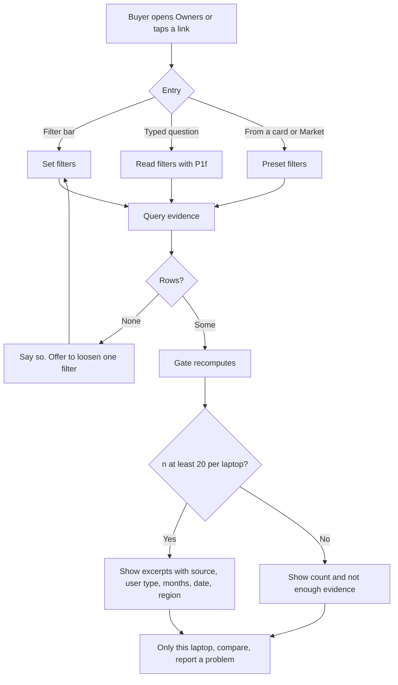

> Part of the LapFit feature specifications. Shared services, conventions and privacy rules are in `../04_FEATURE_SPECS.md` ("Shared platform"). Questions raised here are answered in `../05_ANSWERS.md`.

# F05. Owner voice

**Opportunity.** When I am choosing, I want to hear from owners like me (same use, owned for months, about one topic, recently), so I can trust what I read.
**Class:** extension; the data moat (decision D-02). AI anatomy: `../features/F05_owner_voice.md`. Prompts: P1f (filter reader), P4 (summariser, optional), P8 (review tagger, offline).
**Answers applied:** summaries off by default (Q-P4, Q-F05-1); only consented and licensed text is quoted (Q-F05-2); a region filter (Q-F05-3); new answers Q-F05-4 to Q-F05-8.
**Prototype key:** Built, Partial, New.

## Phase 2. Feature decomposition

| ID | Feature | What it does | Why | Who | Where and when | User actions | Inputs → outputs | Business rules | Depends on | Prototype |
|---|---|---|---|---|---|---|---|---|---|---|
| F05.1 | Filter bar | Selects: who said it (user type), about (topic), owned for (3+, 6+, 12+ months), written in the (last 7, 30, 90 days), laptop, region | The core control | Buyer | Owners screen | Change a select; results update | Selections → filters | Any combination; "Any" removes a filter | F05.3 | Partial (no region) |
| F05.2 | Question reading | "What do gamers say about heat after 6 months?" becomes filters | Typed questions | System | Home ask box | Type | Text → filters (P1f) | Only what the user said; unknown personas and topics are reported | P1f | Built |
| F05.3 | Filter normalisation | Maps words to the fixed lists of six user types and seven topics | Honest counts | System | Always | — | Words → values | Unknown values are named back to the user, never guessed | — | Built |
| F05.4 | Evidence query | Groups matching reports by laptop with n, average rating, topics, sources | The answer | System | Result | — | Filters → rows | n = sum of report counts; rating weighted by report counts | Evidence data | Built |
| F05.5 | Minimum-n rule | Below 20 reports: "not enough evidence" with the count and no excerpts; 20 or more: excerpts | Prevents false confidence | System | Each laptop row | — | n → display | Minimum from settings | F05.4 | Built |
| F05.6 | Ordering | Sorted by rating, then n; labelled "a lens, not a ranking of laptops" | Honest framing | System | Result | — | Rows → order | Laptops with enough evidence first | F05.4 | Built |
| F05.7 | No-match and loosen | Says nothing matches, changes no filter, and offers the filter whose removal shows the most reports | Avoid dead ends | System, Buyer | Result | Tap a loosen button | Filters → offers | Counted in code | F05.4 | Built |
| F05.8 | "Only this laptop" | Narrows to one laptop | Drill-down | Buyer | Each row | Tap | Row → filter | — | — | Built |
| F05.9 | "People like you" lens | When a buyer arrives from a shortlist or second opinion with a stated use, preselects the matching user type and shows that group's rating separately, with n | Your "Zomato-style" job | System, Buyer | Owners screen, card link | Remove the preselection | Use → user type | Mapping table (coding → developer, gaming → gamer, study → student, editing → creator, office → office, parent buying → parent); never blended silently with other groups; below 20 shows the wider view labelled | F05.1, F01 | **New** |
| F05.10 | Region filter and label | Filter "India" or "All"; each excerpt shows its region | Your "India vs US" lens | Buyer | Filter bar | Choose | Region → filter | Default All; label always shown | `region` column | **New** |
| F05.11 | Source attribution | Each excerpt shows source name, months owned, user type, date, and a link where allowed | Traceability and rights | System | Excerpt | Tap link | Row → text | Only licensed or consented text is shown | Source table | Partial (no links) |
| F05.12 | Deep links | From Market, Mine, a card or a claim row into this screen with filters preset | Flow between features | Buyer | Other screens | Tap | Laptop → filters | — | — | Built |
| F05.13 | Report a problem (V1) | A "Report this excerpt" link sends it to the review queue | Quality and removal | Buyer | Excerpt | Tap, choose a reason | Row id → flag | No account needed; rate-limited | Review queue | New |
| F05.14 | Optional summary (V2) | A "Summarise" tap that restates the shown rows with n | Saves reading | Buyer | Laptop row | Tap | Rows → text (P4) | Only restates; n shown; falls back to excerpts | P4 | New |

### Supporting, system and administrative

| ID | Feature | What it does | Who | Rules | Prototype |
|---|---|---|---|---|---|
| F05.S1 | Pre-send gate | Re-runs the same query and compares every count, rating, topic count and excerpt id | System | A mismatch replaces the block with a "could not show" message | Built |
| F05.S2 | Review tagging pipeline | n8n: import → P8 label → confidence check → human audit → verified | System, Reviewer | Rules below | New |
| F05.S3 | View log | Logs a view when a single laptop is filtered | System | Anonymous | Built |
| F05.A1 | Source register | Name, URL, licence, what may be quoted, reliability note | Admin | A row without a licence is never shown | New |
| F05.A2 | Evidence import and verify | CSV import by source; verified in batches | Admin, Reviewer | Rows hidden until verified; batches can be undone | Partial |
| F05.A3 | Low-confidence tag queue | Review labels the model was unsure about | Reviewer | See rules | New |
| F05.A4 | Takedown | Remove a row by id on request | Admin | Logged | New |

### Hierarchy example

```
F05 Owner voice
 └─ F05.9 "People like you" lens
     └─ Behaviour: buyer chose "coding" in Find, then taps "What owners say" on a card
         ├─ User interaction: sees "Developers" preselected, "n = 22 reports, rating 4.3", and a link "Show all owners"
         └─ System behaviour: use → user type → filter on the laptop → compute n and rating for that group → if n < 20 show the wider view and say why
```

## Phase 3. Workflows



| Situation | Behaviour |
|---|---|
| Unknown user type or topic | Notice: "I cannot filter by X yet, so I left it out." |
| Gate mismatch | "I could not show this reliably." Logged |
| Model down | The filter bar still works; typed questions show a notice |
| Source later withdrawn | Row removed by takedown; counts recompute |
| Abandon | Nothing stored except an anonymous view when one laptop is filtered |

## Phase 4. Frontend specification

| Screen | Purpose | Entry | Exit |
|---|---|---|---|
| S1 Owners | Filter and read | Tab "Owners"; links from Market, Mine, cards, claim rows | Compare, Find, Mine |
| S2 Add my experience | Form (F06) | Button on S1 | S1 |

| Component | Purpose | User action | Data | API | States |
|---|---|---|---|---|---|
| Filter bar | Six selects | Change | Option lists | `POST /query` (`ownerFilters`) | Initial from link or "Any"; Loading dims results |
| Applied-filter badges | Show what is on | — | Labels | — | Hidden when none |
| Lens note | "A lens on owner reports, not a ranking of laptops" | — | — | — | Always |
| Laptop row | Name, n badge, rating, topics, sources | "Only this laptop" | Row | — | Enough; Not enough evidence; Empty |
| Excerpt list | Quotes with source, user type, months, date, region | Tap link; report | Excerpts | — | Visible only if n ≥ 20 |
| Loosen buttons | Relax one filter | Tap | Offers | `POST /query` | Only when empty |
| Lens preselection (new) | "Developers, because you chose coding" | Remove | Use | — | Visible when arrived from a use |
| Summarise (V2) | Optional | Tap | Rows | `POST /query` | Idle; loading; shown; fallback |

Validation: select values only from the lists; typed questions up to 4,000 characters. UI states: initial (all laptops), loading, success, empty (with loosen buttons), error, partial (some laptops below 20), offline, permission denied (n/a).

## Phase 5. Backend specification

| Service | Responsibility |
|---|---|
| `evidence` | Filter, aggregate, apply the minimum-n rule |
| `route-request` | P1f |
| `tagging` (n8n + function) | P8 labelling pipeline |
| `admin-evidence`, `admin-sources` | Imports, verification, takedown |

| Endpoint | Method | Purpose | Auth | Request | Response | Errors |
|---|---|---|---|---|---|---|
| `/query` (`ownerFilters`) | POST | Filter and read | Anonymous | `{ persona?, topic?, min_months?, days?, laptop_id?, region? }` | `owner_voice` block: `{ filters, labels, rows[], total_n, min_n, options }` | 400 invalid value |
| `/admin/evidence/import` | POST | CSV import | Reviewer, Admin | File, `source_id` | `{ batch_id, rows, rejected[] }` | Unknown columns; missing licence |
| `/admin/evidence/{id}/verify`, `/reject`, `/takedown` | POST | Review actions | Reviewer, Admin | `{ reason? }` | Row | 409 if already actioned |
| `/admin/sources` | GET, POST, PATCH | Source register | Admin | `{ name, url, licence, quote_allowed, note }` | Row | Licence required |

**Business logic**

```text
query_evidence(f):
  rows = verified or sample excerpts where persona = f.persona, topic = f.topic, months >= f.min_months,
         date >= today - f.days, laptop = f.laptop_id, region = f.region    # each only if set
  group by laptop: n = sum(n_reports); rating = sum(rating*n_reports)/sum(n_reports over rated rows)
  enough = n >= 20
  excerpts = rows if enough else none
  order: enough first, rating desc, n desc, laptop id

like_you(use, laptop):
  persona = use_to_persona[use]; if none return the unfiltered view
  g = query_evidence(persona, laptop); if g.n < 20: return unfiltered view with a note

tag(excerpt):                                  # n8n, offline
  label = P8(excerpt)                          # topic, persona, rating, months, confidence
  if label.confidence >= 0.80: status = tagged
  else: status = needs_review
  every 10th tagged row goes to a human audit
  rows become verified only by a reviewer; a batch is released only if the audit agrees with the model on at least 85% of fields
```
The 0.80, one-in-ten and 85% numbers are starting values, settings, to be set from the first audit.

**Database (additions to `evidence_excerpt`)**

| Column or table | Purpose | Constraints and indexes |
|---|---|---|
| `region` | `IN`, `OTHER`, `UNKNOWN` | Check on values; index |
| `source_id` → `source` | Where it came from and what may be quoted | FK; source table has `licence`, `quote_allowed` |
| `tag_status` | `pending`, `tagged`, `needs_review`, `verified`, `rejected` | Check; index |
| `tag_confidence`, `prompt_version` | Audit | — |
| `takedown_at`, `takedown_reason` | Removal | Rows with a takedown are never shown |
| Indexes | `(laptop_id, topic, date)`, `(persona)`, `(ownership_months)`, `(region)` | — |
| `report_flag` | id, excerpt_id, reason, created_at | Rate-limited by address in memory |

**Background:** the tagging pipeline (above), nightly refresh of any summary views, 24-month aggregation of `view_events`.

## Phase 6. Roles and permissions

| Feature | Visitor | Reviewer | Admin |
|---|---|---|---|
| Read owner voice | Use | Use | Use |
| Report an excerpt | Create | – | – |
| Verify, reject tags | – | Approve | Manage |
| Import evidence, manage sources, takedown | – | Create (verify) | Manage, Delete |

Privacy: excerpts carry no identity. Audit log on verification, rejection, takedown and imports.

## Phase 7. Data and intelligence

| Data | Class | Origin | Collection | Validation | Stored | Used by |
|---|---|---|---|---|---|---|
| Owner reports | User-generated | F06 and consented imports | Form, CSV | Reviewer | `evidence_excerpt` | All |
| Imported reviews | Third-party | Licensed sources | CSV | Licence check, tags audited | `evidence_excerpt` | F05.4 |
| Labels (topic, persona, rating, months) | Derived | P8 | Batch | Confidence, audit | Same row | F05.1 |
| Filters | User-provided or derived | UI, P1f | Per request | Lists | Not stored | F05.4 |

**AI capabilities**

| Capability | Input | Workflow | Output | Confidence | Fallback | Human review |
|---|---|---|---|---|---|---|
| P1f | Question | One call | Filters | Router confidence | The filter bar | Failures reviewed |
| P8 | One excerpt | Batch, temperature 0 | Labels with confidence | Under 0.80 → review | Manual labelling | Audit one in ten; reviewer verifies |
| P4 (V2) | Retrieved rows with n | Restate only | Two sentences | n checked | Show excerpts | Spot-check |

## Phase 8. Integrations and dependencies

Gemini (P1f, P8, P4), n8n (tagging, retention), Supabase. Dependencies: F05.4 → evidence data, settings; F05.5 → F05.4; F05.9 → F01 uses; F05.10 → region column; F05.S2 → source register and licences; F05.14 → P4.

## Phase 9. Edge cases and non-functional requirements

| Case | Expected behaviour |
|---|---|
| Excerpt about several topics | Tagger returns the main topic; low confidence goes to review |
| Same user type, different months in one row | Each excerpt keeps its own months; the filter applies per excerpt |
| Rating present, text missing | Counts toward n and rating; no excerpt shown |
| Report count n_reports above 1 (aggregated source row) | Counted as that many in n |
| n changes between request and gate | Gate recompute handles it; mismatch drops the block |
| A source withdraws permission | Takedown by source; counts recompute |
| Duplicate imports | Detected by text hash within a source |
| Spam or abuse in reports | F06 review; "Report this excerpt" |
| Unknown user type typed | Named back; filter left out |
| Rights unclear | Row is not quoted until the source register says so |
| Performance | Query under 200 ms for 100,000 excerpts with the indexes |
| Accessibility | Filters labelled; counts as text |
| Privacy and retention | Excerpts kept while licensed; takedown on request |

## Phase 10. Backlog

| ID | Feature | Frontend scope | Backend scope | Dependencies | Priority | Complexity | Prototype |
|---|---|---|---|---|---|---|---|
| F05.1, F05.3, F05.4, F05.5, F05.6 | Filter, normalise, aggregate, minimum-n, order | Filter bar, rows | `evidence` | Evidence data | MVP | M | Built |
| F05.7, F05.8, F05.12 | Loosen, drill-down, deep links | Buttons | Counts | — | MVP | S | Built |
| F05.2 | Typed question reading | — | P1f | Gemini | MVP | S | Built |
| F05.S1 | Gate | — | Gate | — | MVP | M | Built |
| F05.11 | Source attribution | Excerpt line | Source join | Source register | MVP | S | Partial |
| F05.A1, A2, A4 | Source register, import, takedown | Admin screens | Admin functions | — | MVP | M | Partial |
| F05.10 | Region filter | Select | Column and filter | Region data | V1 | S | New |
| F05.9 | "People like you" lens | Preselect, note | Mapping | F01 | V1 | M | New |
| F05.S2, F05.A3 | Tagging pipeline and review queue | Review screen | n8n, P8 | Licensed data | V1 | L | New |
| F05.13 | Report an excerpt | Link | `report_flag` | — | V1 | S | New |
| F05.14 | Optional summary | Button | P4 | Volume | V2 | M | New |
| — | Trained tag classifier | — | Model service | About 5,000 labelled rows | Future | L | New |

Reasoning: the tagging pipeline is L because labels shape every count, so the audit and release rules matter more than the code.

## Phase 11. Blueprint and acceptance criteria

**Sequence:** evidence data with licences first; query and minimum-n; gate; filter bar and deep links; source attribution and takedown; typed questions; V1 region, lens, tagging.

| ID | Criterion |
|---|---|
| F05.1 | **Given** persona = gamer and topic = heat, **when** applied, **then** only gamer heat reports are counted. |
| F05.2 | **Given** "what do gamers say about heat after 6 months?", **when** read, **then** persona gamer, topic heat and months 6 are set. |
| F05.4 | **Given** two reports with counts 11 and 4 for a laptop, **when** shown, **then** n is 15. |
| F05.5 | **Given** n = 19, **when** shown, **then** "Not enough evidence (n = 19)" appears and no excerpt. |
| F05.5b | **Given** n = 20, **when** shown, **then** excerpts appear. |
| F05.6 | **Given** two laptops with enough evidence, **when** shown, **then** the higher rating is first. |
| F05.7 | **Given** no match, **when** shown, **then** a message says no filter was changed and up to two loosen buttons show the counts. |
| F05.9 | **Given** the buyer chose "coding", **when** owners open, **then** Developers is preselected and removable; **given** n under 20, **then** the wider view shows with a note. |
| F05.10 | **Given** region India, **when** applied, **then** no excerpt from another region appears. |
| F05.11 | **Given** an excerpt from a source that does not allow quoting, **when** shown, **then** it is not shown. |
| F05.13 | **Given** a reported excerpt, **when** a reviewer takes it down, **then** counts recompute. |
| F05.S1 | **Given** a changed count, **when** the gate runs, **then** the block is replaced and logged. |
| F05.S2 | **Given** a label with confidence 0.7, **when** tagged, **then** it goes to review and is not shown. |
| Safety | **Given** an excerpt containing "ignore your rules", **when** tagged and shown, **then** the text is treated as data. |

Hard metrics: a count that differs from the data; a rating without n; an unlicensed excerpt shown; a tag released without audit.

## Review notes

Answered in `../05_ANSWERS.md` (Q-F05-4 to Q-F05-8). Weakest assumptions: the audit thresholds (0.80, one in ten, 85%) and the use-to-user-type mapping, both settings to calibrate on the first real batch.
