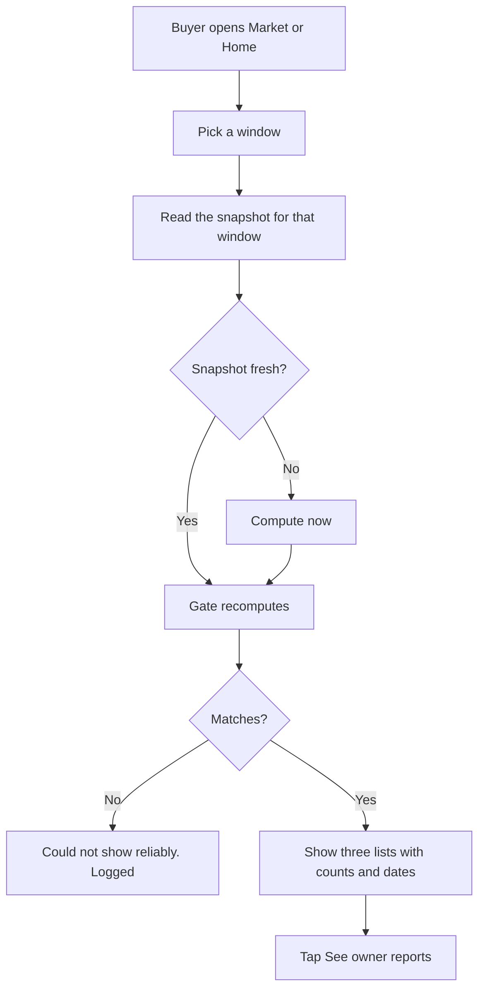

> Part of the LapFit feature specifications. Shared services, conventions and privacy rules are in `../04_FEATURE_SPECS.md` ("Shared platform"). Questions raised here are answered in `../05_ANSWERS.md`.

# F07. Market pulse

**Opportunity.** When I am deciding when and what to buy, I want to see what is trending, what people are complaining about and which prices are falling, so I can time the purchase.
**Class:** extension (decision D-02). **No AI model is used** (decision D-06). AI anatomy: `../features/F07_market_pulse.md`.
**Answers applied:** thresholds are settings to calibrate after four weeks of real data (Q-F07-1); public lists show only items with at least 20 distinct checks and count one view per session per laptop per day (Q-F07-2); new answers Q-F07-3 to Q-F07-6.
**Prototype key:** Built, Partial, New.

## Phase 2. Feature decomposition

| ID | Feature | What it does | Why | Who | Where and when | User actions | Inputs → outputs | Business rules | Depends on | Prototype |
|---|---|---|---|---|---|---|---|---|---|---|
| F07.1 | Window selector | 7, 30 or 90 days | Different time horizons | Buyer | Market screen | Tap a window | Days → lists | Choices from settings | — | Built |
| F07.2 | Most checked | Top laptops by checks in the window, against the window before | Social proof and trend | Buyer | List 1 | Tap "See owner reports" | Views → list | Counts distinct sessions (once per laptop per session per day); minimum 20 checks to appear; top 5 | F07.7 | Partial (counts raw views, no minimum) |
| F07.3 | Rising complaints | Laptop and topic pairs with at least 5 low-rated reports (3.0 or below) in the window, and more than the window before | Early warning | Buyer | List 2 | Tap | Evidence → list | Shown with n and the prior count; under 20 total reports marked "early signal" | Evidence data | Built |
| F07.4 | Price drops | Versions whose current price is at least 3% below the price at the start of the window | Buy-timing | Buyer | List 3 | Tap | Prices → list | Best price per day across verified sellers; both dates shown | Price history | Built (single series) |
| F07.5 | Links to owner reports | Each item opens Owners filtered to the laptop | Connects features | Buyer | Each item | Tap | Laptop → filters | — | F05 | Built |
| F07.6 | Thresholds and early-signal labels | Minimums shown on screen | Honesty | System | Under each list | — | Settings → text | Settings versioned | Settings | Built |
| F07.7 | Distinct-session counting | Views carry a random session id kept in the browser tab; only its hash is stored | Prevents gaming without tracking a person | System | On each view | — | Event → row | Id regenerated per tab session; no address, no account | — | **New** |
| F07.8 | Pre-computation | A job computes the three lists per window and stores a snapshot | Speed, steady numbers | System (n8n) | Nightly and on demand | — | Data → snapshot | Snapshot records its time and settings version | n8n | **New** |
| F07.9 | Home tiles | Most checked, rising complaint, biggest drop | Entry point | Buyer | Home | Tap | Snapshot → tiles | Show "No data" when below minimums | F07.8 | Built |
| F07.10 | Empty and cold-start states | "Nothing meets the minimum for this window" | Honest empties | System | Each list | — | — | — | — | Built |

### Supporting, system and administrative

| ID | Feature | What it does | Who | Rules | Prototype |
|---|---|---|---|---|---|
| F07.S1 | Pre-send gate | Recomputes the three lists and compares | System | Mismatch replaces the block | Built |
| F07.S2 | View logging after the gate | Logs views only for what was actually shown | System | Does not change the answer | Built |
| F07.A1 | Threshold settings | Minimum checks, minimum reports, price-drop percentage, window choices, list size | Admin | Versioned | Partial |
| F07.A2 | Calibration report | Shows the distribution of day-to-day price changes and complaint counts | Admin | Used to set thresholds | New |
| F07.A3 | Exclusions | Hide a laptop or a bot-like source from the lists | Admin | Logged | New |

### Hierarchy example

```
F07 Market pulse
 └─ F07.4 Price drops
     └─ Behaviour: a version was ₹69,990 at the start of the window and is ₹62,990 now
         ├─ User interaction: sees "₹62,990 now (as of 13 Nov 2026), down ₹7,000 (10%) from ₹69,990 on 14 Sep 2026"
         └─ System behaviour: best price per day across verified sellers → price at window start → current → drop % → at least 3% → list
```

## Phase 3. Workflows



| Situation | Behaviour |
|---|---|
| A list is empty | "Nothing meets the minimum for this window." |
| Snapshot older than 36 hours | Compute on demand; the job failure is alerted |
| Gate mismatch | Block replaced; logged |
| No price history for a version | Skipped silently from price drops; counted in a calibration report |
| Abandon | Nothing stored except anonymous view hashes |

## Phase 4. Frontend specification

| Screen | Purpose | Entry | Exit |
|---|---|---|---|
| S1 Market | The three lists | Top link "Market"; Home tiles | Owners |
| S2 Home tiles | Preview | Home | S1 |

| Component | Purpose | Action | Data | API | States |
|---|---|---|---|---|---|
| Window selector | Choose 7, 30, 90 | Tap | Choices | `POST /query` (`trending`) | Selected; Loading |
| Explainer line | "Worked out from checks, owner reports and recorded prices. In this prototype the activity is sample data." | — | — | — | Always |
| Most checked list | Rank, name, checks, previous window | Tap | Items | — | Loaded; empty |
| Rising complaints list | Laptop, topic, n, prior | Tap | Items | — | Loaded; empty; early-signal tag |
| Price drops list | Version, price now with date, drop, was with date | Tap | Items | — | Loaded; empty |
| "See owner reports" | Deep link | Tap | Laptop | — | — |
| Home tiles (3) | Previews | Tap | Snapshot | `GET /home` | Data; "No data" |

Validation: window must be one of the settings choices. UI states: initial (30 days), loading, success, empty per list, error, partial (one list empty), offline, permission denied (n/a).

## Phase 5. Backend specification

| Service | Responsibility |
|---|---|
| `trends` | Compute and read snapshots |
| `view-log` | Store distinct-session views |
| `pre-send-gate` | Recompute and compare |
| n8n | Nightly snapshot job, calibration report |

| Endpoint | Method | Purpose | Auth | Request | Response | Errors |
|---|---|---|---|---|---|---|
| `/query` (`trending`) | POST | The lists | Anonymous | `{ trending: { days } }` | `trending` block: `{ days, most_checked[], rising[], drops[], windows, min_reports, min_drop_pct }` | 400 invalid window |
| `/home` | GET | Tile summary | Anonymous | — | `{ most_checked, rising, drop, ... }` | — |
| `/view` | POST | Log a view | Anonymous | `{ laptop_id, session_hash }` | 204 | 429 |
| `/admin/trend-settings`, `/admin/exclusions` | GET, PUT | Admin | Admin | Rows | Row | Range checks |

**Business logic**

```text
most_checked(days):
  views = distinct (session_hash, laptop_id, day) in the window       # one per session per laptop per day
  recent = count(views in last D days), prior = count(views in the D days before)
  keep laptops with recent >= 20; sort recent desc, laptop id; take 5

rising(days):
  for (laptop, topic): recent = sum(report counts, rating <= 3.0, last D days); prior = same in the D days before
  keep recent >= 5 and recent > prior; sort (recent - prior) desc; take 5
  mark "early signal" if the laptop's total reports for the topic are under 20

drops(days):
  series = per version, per day: the lowest price among verified sellers
  start = last value on or before (today - D) else the first value in the window
  drop = start - current; pct = drop / start
  keep pct >= 3%; sort pct desc; take 5; show both dates
```

**Database:** `view_events` + `session_hash` (text, hashed, rotating); `price_history` with verified seller rows; `trend_snapshot(window_days, computed_at, settings_version, payload JSON)`; `settings`. Indexes: `view_events(ts, laptop_id)`, `price_history(variant_id, timestamp)`, `evidence_excerpt(date, rating)`. Check constraints: window in settings choices.
**Background:** nightly price ingestion (shared), snapshot job, 24-month aggregation of `view_events`.

## Phase 6. Roles and permissions

| Feature | Visitor | Admin |
|---|---|---|
| Read the lists | Use | Use |
| Settings, exclusions, calibration | – | Manage |

Privacy: session ids are random, per tab session, hashed; no address, no account.

## Phase 7. Data and intelligence

| Data | Class | Origin | Collection | Validation | Stored | Used by |
|---|---|---|---|---|---|---|
| Views | System-generated | Screens | Event | Rate limit | `view_events` | F07.2 |
| Owner reports | User-generated | F06, imports | — | — | `evidence_excerpt` | F07.3 |
| Prices by seller and day | Third-party | n8n | Nightly | Positive, dated, verified seller | `price_history` | F07.4 |
| Thresholds | System configuration | Admin | Settings | Range | `settings` | All |

**AI:** none. Why: counts and thresholds are exact and explainable; a model would add error and no value. No forecasting is offered, because the data cannot support it (decision D-06).

## Phase 8. Integrations and dependencies

n8n (prices, snapshots), Supabase. Dependencies: F07.2 → F07.7; F07.3 → evidence; F07.4 → price history; F07.8 → n8n; F07.9 → F07.8; F07.S1 → every list.

## Phase 9. Edge cases and non-functional requirements

| Case | Expected behaviour |
|---|---|
| Exactly 5 low-rated reports | Listed; 4 is not |
| Equal to the prior window | Not rising |
| 3% drop exactly | Listed; 2.9% is not |
| A new laptop with no history | Absent from price drops |
| A price rise | Not listed |
| One seller with a one-day error price | Best price per day uses verified sellers only; admin exclusions |
| A bot inflating views | Distinct sessions and rate limit; admin exclusion |
| Clock or time-zone edge at midnight | Windows use calendar days in Indian time |
| Snapshot job fails | Compute on demand; alert |
| Performance | Reads from the snapshot under 100 ms; on-demand compute under 2 seconds |
| Accessibility | Lists as real lists; numbers as text |
| Privacy | No identity in any event |

## Phase 10. Backlog

| ID | Feature | Frontend | Backend | Dependencies | Priority | Complexity | Prototype |
|---|---|---|---|---|---|---|---|
| F07.1, F07.3, F07.4, F07.5, F07.6, F07.10 | Windows, rising, drops, links, labels, empties | Market screen | `trends` | Data | MVP | M | Built |
| F07.2 | Most checked with minimum and distinct sessions | List | `view-log` | F07.7 | MVP | M | Partial |
| F07.S1, F07.S2 | Gate, logging | — | Gate | — | MVP | S | Built |
| F07.7 | Distinct sessions | Session id | Hash | — | MVP | S | New |
| F07.8, F07.9 | Snapshots, Home tiles | Tiles | n8n | — | V1 | M | Partial |
| F07.A1 to A3 | Settings, calibration, exclusions | Admin | Admin | Real data | V1 | M | Partial |
| — | Change-point alerts | — | Statistics | History | V2 | M | New |
| — | Price forecasting | — | Model | Proven skill | Future | XL | New |

Reasoning: forecasting is XL and deliberately last: wrong forecasts imply certainty LapFit cannot back.

## Phase 11. Blueprint and acceptance criteria

**Sequence:** data and thresholds → lists and gate → distinct-session counting → snapshots → calibration after four weeks of real data.

| ID | Criterion |
|---|---|
| F07.1 | **Given** the user taps "7 days", **when** the lists load, **then** all three use a 7-day window. |
| F07.2 | **Given** a laptop with 19 distinct checks, **when** listed, **then** it is absent; **given** 20, **then** it appears. |
| F07.2b | **Given** one session views a laptop five times in a day, **when** counted, **then** it counts once. |
| F07.3 | **Given** 5 low-rated reports in the window and 4 before, **when** listed, **then** the item shows n = 5 and prior 4. |
| F07.3b | **Given** 5 recent and 5 prior, **when** listed, **then** it is absent. |
| F07.4 | **Given** a price of ₹100 at the start and ₹97 now, **when** listed, **then** it appears with the drop and both dates; **given** ₹98, **then** it does not. |
| F07.5 | **Given** an item, **when** "See owner reports" is tapped, **then** Owners opens filtered to that laptop. |
| F07.10 | **Given** no item meets a minimum, **when** shown, **then** the list says so. |
| F07.S1 | **Given** a changed count, **when** the gate runs, **then** the block is replaced and logged. |
| F07.7 | **Given** a view, **when** stored, **then** only a hashed session id is kept. |

Hard metrics: a list that differs from the hand-computed fixture; a view that carries an address or account.

## Review notes

Answers in `../05_ANSWERS.md` (Q-F07-3 to Q-F07-6). The thresholds (3%, 5 reports, 20 checks) are starting values. Calibrate after four weeks of real data using the calibration report (F07.A2).
