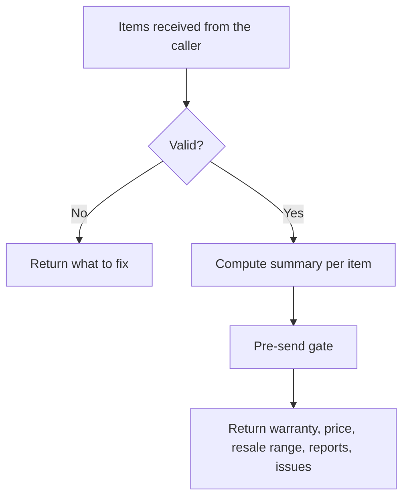

> Part of the LapFit feature specifications. Shared services, conventions and privacy rules are in `../04_FEATURE_SPECS.md` ("Shared platform"). Questions raised here are answered in `../05_ANSWERS.md`.

> **Functional requirements only.** This file says what the system must do, not which screens exist. Screen specifications are written after the frontend is built (see `../../build-plan/03_FRONTEND_JOBS_AND_TRIGGERS.md`). Earlier UI notes are kept as drafts in `../../build-plan/frontend-notes-for-later/`.

# F08. My laptops

**Opportunity.** As an owner, I want one place that tells me my warranty status, what my laptop is worth and what others report about it, so I can look after it and decide when to act.
**Class:** extension (decision D-02). **No AI model is used.** AI anatomy: `../features/F08_my_laptops.md`.
**Answers applied:** on-device version only in the course scope; accounts are V2 (Q-F08-1); new answers Q-F08-2 to Q-F08-6.
**Prototype key:** Built, Partial, New.

## Phase 2. Feature decomposition

| ID | Feature | What it does | Why | Who | Inputs → outputs | Business rules | Depends on | Prototype |
|---|---|---|---|---|---|---|---|---|
| F08.1 | Add a laptop | Choose the exact version, purchase date, optional price paid | Everything is calculated from these | Owner | Form → saved item | Version from the catalog list | Catalog | Built |
| F08.2 | Validation | Date not in the future; price paid 1 to 1,00,00,000 or empty | Quality | System | Form → errors | — | — | Partial |
| F08.3 | On-device storage | Saves the list in the browser; works without saving if storage is blocked, and says so | Privacy | System | Items → storage | Reads and writes in try and catch | — | Built |
| F08.4 | Summary calculation | The server returns computed figures for the saved items; nothing is stored there | Keeps logic in one place | System | Items → summaries | Stateless; ten items at most | `garage` function | Built |
| F08.5 | Warranty countdown | Days left and end date | The most-forgotten fact | Owner | Date, years → days left | Warranty runs from the purchase date [A: invoice date]; shows the catalog text too | Catalog | Built |
| F08.6 | Price now vs paid | Today's price with its as-of date, and the gap | Know value | Owner | Price → gap | Neutral wording; no claims about refunds or price protection | Catalog | Built |
| F08.7 | Rough resale range | A range from the sell-plan rules, labelled sample | Value in the future | Owner | Price → range | Same function as F09; "A real range needs real used prices" | F09 | Built |
| F08.8 | Owner reports and complaints | Rating with n and rising complaints for the model | Context | Owner | Evidence → text | n shown; under 20 reads "not enough evidence" | F05, F07 | Built |
| F08.9 | Actions | What owners say; share my experience (after 1 month); sell this laptop; remove | Connects features | Owner | — | — | F05, F06, F09 | Built |
| F08.10 | Edit and remove | Change the date or price; remove | Mistakes happen | Owner | Item → item | Remove asks to confirm | — | Partial (remove only) |
| F08.11 | Export and import (V1) | Download the list as a file; load it on another device | Backup without an account | Owner | Items ↔ file | Local file only; never uploaded | — | **New** |
| F08.12 | Reminders (V2) | Warranty and report reminders | The job includes remembering | Account holder | Dates → messages | Needs accounts and a channel | Accounts, n8n | New |
| F08.13 | Accounts and sync (V2) | Keep the list across devices | Continuity | Account holder | Items → server | Consent and deletion | Accounts | New |

### Supporting, system and administrative

| ID | Feature | What it does | Who | Rules | Prototype |
|---|---|---|---|---|---|
| F08.S1 | Gate for figures | Recomputes dates and gaps from stored values | System | Mismatch drops the result item's figures | New |
| F08.S2 | Privacy notice | One line: "Saved on this device only" | System | Always shown | Built |
| F08.A1 | Warranty rule table | Per brand or model exceptions to "years from purchase" | Admin | Versioned, with source | New |
| F08.A2 | Catalog warranty fields | `warranty`, `warranty_years` | Admin | Verified | Built |

### Hierarchy example

```
F08 My laptops
 └─ F08.5 Warranty countdown
     └─ Behaviour: bought 1 Mar 2026, warranty 1 year, today 13 Nov 2026
         ├─ User receives: "Warranty: 108 days left (1 year, ends 1 Mar 2027)"
         └─ System behaviour: purchase date + warranty years → end date → days between today and end → label "ended" if not positive
```

## Phase 3. Workflows



| Situation | Behaviour |
|---|---|
| Storage blocked | Works for the session; says "Not saved on this device" |
| Version no longer in the catalog | Shows the saved data and "no longer in the catalog" |
| Server unreachable | Shows the saved facts without computed figures and a notice |
| Date today | Allowed; "Owned 0 months" |
| Abandon | Nothing leaves the device |

## Phase 5. Backend specification

| Endpoint | Method | Purpose | Auth | Request | Response | Errors |
|---|---|---|---|---|---|---|
| `/garage` | POST | Compute summaries | Anonymous, rate-limited | `{ items:[{ variant_id, bought_on, paid_inr? }] }` (≤10) | `{ ok, items:[summary] }` | 400 invalid items |
| `/catalog` | GET | Version list | Anonymous | — | Variants | — |

**Summary fields:** name, version, months owned, warranty text, warranty end, days left, price now with as-of date, price gap, resale low and high, rating with n, rising complaints, report-due flag.

**Business logic**

```text
summary(item):
  v = variant(item.variant_id); require bought_on <= today
  months = whole months between bought_on and today
  end = bought_on + v.warranty_years; days_left = end - today
  gap = paid - v.price_now if paid else none
  resale = (v.price_now * band_low, v.price_now * band_high), rounded to ₹100   # same function as F09; sample band
  report_due = months >= 1
```

**Database:** none for the on-device version. V2: `account`, `garage_item(account_id, variant_id, bought_on, paid_inr, serial_hash?)`, `price_alert`, `consent_log` (data model, section 9.2) with row-level security so a person sees only their own rows.
**Background:** none now; V2 reminders by n8n.

## Phase 6. Roles and permissions

| Feature | Visitor | Account holder (V2) | Admin |
|---|---|---|---|
| Use the My-laptops functions | Use | Use, sync | Use |
| Delete own data | (device) | Delete | Delete on request |
| Warranty rules, catalog fields | – | – | Manage |

Privacy: nothing about a person's laptops is stored on the server in the on-device version; the list is sent only to compute summaries and not logged.

## Phase 7. Data and intelligence

| Data | Class | Origin | Collection | Validation | Stored | Used by |
|---|---|---|---|---|---|---|
| Owned laptops | User-provided | Owner | Form | Ranges | Device | All |
| Catalog and price | Third-party, manual | Import, n8n | — | Verified, dated | Server | F08.4 to F08.7 |
| Evidence | User-generated | F05, F06 | — | — | Server | F08.8 |
| Resale band | System configuration (sample) | Settings | — | — | Settings | F08.7 |

AI: none. All outputs are calculations; a wrong warranty date could cost an owner a claim, so dates show their rule.

## Phase 8. Integrations and dependencies

Supabase; n8n (V2). Dependencies: F08.4 → catalog; F08.7 → F09 value function; F08.8 → F05 and F07; F08.12 → accounts; F08.13 → accounts and consent.

## Phase 9. Edge cases and non-functional requirements

| Case | Expected behaviour |
|---|---|
| Warranty ends today or yesterday | "Ends today" or "Warranty ended" |
| Leap-day purchase | End date adds years to the date; Feb 29 becomes Feb 28 or Mar 1 per the rule table [A] |
| Purchase date in the future | Rejected |
| Price paid blank | The gap line is hidden |
| Price gap zero | "The same as now" |
| More than 10 items | Asks to remove one |
| Variant removed | Saved data kept; note shown |
| Browser data cleared | The list is gone; export (V1) is the remedy |
| Time zones | Dates are calendar dates in Indian time |
| Performance | Summary under 300 ms for 10 items |
| Privacy | Device only (V1); consent and notice before any account |

## Phase 10. Backlog

| ID | Feature | Backend | Dependencies | Priority | Complexity | Prototype |
|---|---|---|---|---|---|---|
| F08.1, F08.3, F08.4, F08.5, F08.6, F08.8, F08.9 | Add, storage, summary, warranty, price, reports, actions | `garage` | Catalog | MVP | M | Built |
| F08.2, F08.10 | Validation, edit | — | — | MVP | S | Partial |
| F08.7 | Resale range | F09 function | F09 | MVP | S | Built |
| F08.S1 | Gate for figures | Gate | — | MVP | S | New |
| F08.11 | Export and import | — | — | V1 | S | New |
| F08.A1 | Warranty rule table | Table | Source data | V1 | S | New |
| F08.12, F08.13 | Reminders, accounts | Accounts, n8n | Consent, notice | V2 | L | New |
| — | Price alerts | Alerts | Accounts | Future | M | New |

Reasoning: accounts are L because of security, consent, deletion and support, not because of the interface.

## Phase 11. Blueprint and acceptance criteria

**Sequence:** catalog → summary function and gate → summary endpoint tests → validation and edit → export (V1) → accounts only after the core is proven.

| ID | Criterion |
|---|---|
| F08.1 | **Given** a version, date and price, **when** added, **then** it appears with its summary. |
| F08.2 | **Given** a date after today, **when** added, **then** it is rejected with a message. |
| F08.3 | **Given** storage is blocked, **when** the owner adds a laptop, **then** it shows for the session with "Not saved on this device". |
| F08.5 | **Given** bought 1 Mar 2026 with 1 year warranty, **when** viewed on 13 Nov 2026, **then** it shows 108 days left and the end date 1 Mar 2027. |
| F08.6 | **Given** paid ₹69,990 and now ₹62,990, **when** shown, **then** it says the price is ₹7,000 lower and gives no refund claim. |
| F08.7 | **Given** a price now, **when** shown, **then** a resale range appears labelled as a sample band. |
| F08.8 | **Given** n under 20, **when** shown, **then** "not enough evidence (n = …)" appears. |
| F08.9 | **Given** owned under 1 month, **when** shown, **then** no "Share my experience" option appears. |
| F08.10 | **Given** Remove, **when** selected, **then** a confirmation appears before deletion. |
| F08.S1 | **Given** a changed figure, **when** the gate runs, **then** that figure is dropped and logged. |

Hard metrics: a warranty date or price gap that differs from the fixture; any list stored server-side.

## Review notes

Answers in `../05_ANSWERS.md` (Q-F08-2 to Q-F08-6). The assumption that warranty runs from the purchase date should be checked per brand before launch.
