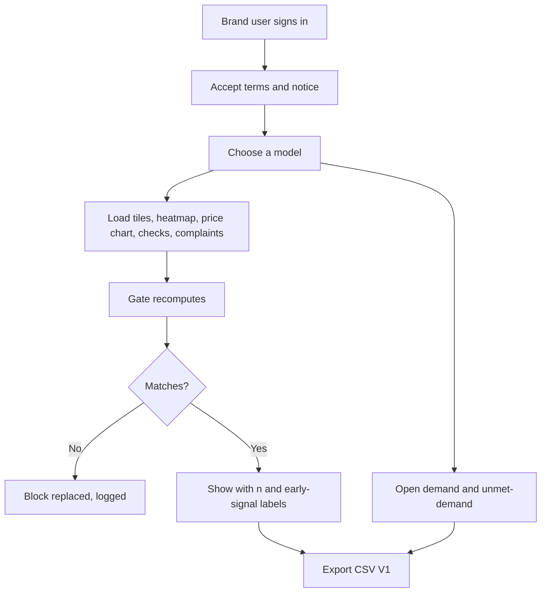

> Part of the LapFit feature specifications. Shared services, conventions and privacy rules are in `../04_FEATURE_SPECS.md` ("Shared platform"). Questions raised here are answered in `../05_ANSWERS.md`.

# F10. Brand and retailer insights

**Opportunity.** As a maker or retailer, I want to know what buyers want, what owners complain about, and where my prices sit, so I can fix the product and the range.
**Class:** extension; a second payer for the same data (decision D-02). AI anatomy: `../features/F10_brand_insights.md`. Prompt: P7 (narrator, V2, optional).
**Answers applied:** no competitor comparisons (Q-F10-2); new answers Q-F10-3 to Q-F10-8 (brand accounts, suppression rule, buyer notice, pricing).
**Important:** in the prototype the demand figures come from **invented searches**. The screen demonstrates the view and is not evidence of demand.
**Prototype key:** Built, Partial, New.

## Phase 2. Feature decomposition

| ID | Feature | What it does | Why | Who | Where and when | User actions | Inputs → outputs | Business rules | Depends on | Prototype |
|---|---|---|---|---|---|---|---|---|---|---|
| F10.1 | Brand sign-in and scope | A brand user signs in and sees their own models in full, and the category in aggregate | Access control | Brand user | Entry | Sign in | Account → scope | Role claim carries the brand id; others see nothing | Auth | **New** (prototype is open) |
| F10.2 | Laptop selector | Choose one of the brand's models | Focus | Brand user | Top | Select | Model → view | Own models only | F10.1 | Built (all models) |
| F10.3 | Summary tiles | Owner rating with n; checks this week vs four weeks ago; rising complaints; price falls | The first look | Brand user | Top | — | Model → tiles | Each shows its n or window | Evidence, views, prices | Built |
| F10.4 | Heatmap: user type by topic | Average rating for each pair, with n; cells under 20 are marked early signals | Who is unhappy about what | Brand user | Middle | Hover or tap a cell | Model → matrix | Cells under 5 reports are hidden; 5 to 19 shown as early signal; 20 or more shown plainly | Evidence | Built (no hide rule) |
| F10.5 | Price history and position | Price by version over time, range, and the position against the category range | Price decisions | Brand user | Middle | Toggle versions | Prices → chart | Verified sellers only; dates shown | Prices | Partial (own prices only) |
| F10.6 | Checks per week | Interest over the last eight weeks | Trend in attention | Brand user | Middle | — | Views → bars | Distinct sessions | F07.7 | Built (raw counts) |
| F10.7 | Rising complaints | Topics with growing low-rated reports for the model | Early warning | Brand user | Middle | — | Evidence → list | As F07.3 | F07 | Built |
| F10.8 | Buyer demand | Budget bands, top uses, top Musts across searches (last 90 days) | What buyers ask for | Brand user | Lower | — | Demand → bars | Cells with fewer than 20 searches are suppressed | Demand data | Built (sample) |
| F10.9 | Unmet-demand briefs | Combinations of budget and Musts that no laptop in the catalog satisfies, with the number of searches | A product brief | Brand user | Lower | Tap a row | Demand → list | Matched = 0; cells under 20 suppressed; shows the share of all searches | F01.S2 | Built (sample) |
| F10.10 | CSV export (V1) | Download what is on screen | Use in their own tools | Brand user | Each section | Tap | View → file | Only what the user may see; export logged | — | New |
| F10.11 | Alerts (V2) | Email when a complaint rises on their model | Monitoring | Brand user | Settings | Opt in | Rule → message | Needs accounts and a channel | Accounts, n8n | New |
| F10.12 | Narrative note (V2, P7) | A two to four sentence note from the computed numbers | Saves reading | Brand user | Top | Tap | Numbers → text | Every number in the note appears in the input; thin data marked | P7 | New |
| F10.13 | Terms and notice | A page saying what the data is, that it is aggregate and anonymous, and the limits | Trust and legal | Brand user | Footer | Read | — | Version stored on acceptance | Notice | **New** |
| F10.14 | Access log | Who viewed or exported what, and when | Accountability | System | — | — | Event → row | Append only | — | **New** |

### Supporting, system and administrative

| ID | Feature | What it does | Who | Rules | Prototype |
|---|---|---|---|---|---|
| F10.S1 | Suppression rule | Any figure computed from fewer than the minimum is hidden or marked | System | Minimums in settings | New |
| F10.S2 | Pre-send gate | Recomputes tiles, matrix, chart data and demand lists | System | Mismatch drops the block | New |
| F10.A1 | Brand and user management | Create brands, link models, invite users | Admin | Role and brand id | New |
| F10.A2 | Release rules | What may be shown to brands (fields, minimums, freshness) | Admin | Versioned | New |
| F10.A3 | Sample-data labelling | Labels any view built on sample rows | System | Banner | Built |

### Hierarchy example

```
F10 Brand insights
 └─ F10.9 Unmet-demand briefs
     └─ Behaviour: 21 searches asked for "under ₹40,000, RAM 16 GB or more, weight up to 1.2 kg" and nothing matched
         ├─ User interaction: sees "21 searches: Under ₹40,000, RAM 16 GB or more, weight up to 1.2 kg. 9% of all searches found no laptop."
         └─ System behaviour: demand rows with matched = 0 → group by budget band and Must labels → keep groups of 20 or more → sort by count
```

## Phase 3. Workflows



| Situation | Behaviour |
|---|---|
| Not signed in | Sign-in page; no data |
| Signed in as a brand with no models | "No models are linked to your account yet" |
| Cell below the minimum | Hidden or "early signal" per the rule |
| No data yet | "No owner reports by user type yet" |
| Sample data in use | Banner: "SAMPLE DATA" |
| Gate mismatch | "I could not show this reliably." |

## Phase 4. Frontend specification

| Screen | Purpose | Entry | Exit |
|---|---|---|---|
| S1 Sign-in | Authenticate | Link "For brands" | S2 |
| S2 Insights | The views | After sign-in | Export |
| S3 Terms | Terms and notice | Footer, first sign-in | — |
| A1 Admin: brands | Manage | Admin | — |

| Component | Purpose | Action | Data | API | States |
|---|---|---|---|---|---|
| Sample-data banner | Honesty | — | — | — | Shown on sample data |
| Model selector | Choose a model | Select | Models | `GET /brand/models` | Loaded; empty |
| Tiles (4) | Rating, checks, complaints, price falls | — | Summary | `GET /brand/insights` | Loaded; "None" |
| Heatmap table | Rating and n per cell | Tap a cell | Matrix | same | Normal; early signal (dashed); hidden |
| Price chart | Lines per version with legend | Toggle | Series | same | Loaded; no data |
| Checks bars | Eight weeks | — | Weeks | same | Loaded |
| Complaints list | Topic, n, prior | — | List | same | Loaded; none |
| Demand panel | Bands, uses, Musts | — | Aggregates | `GET /brand/demand` | Loaded; suppressed |
| Unmet-demand list | Briefs | — | List | same | Loaded; none |
| Export buttons (V1) | CSV | Tap | File | `GET /brand/export` | Idle; done |

Validation: model id must be one of the user's. Charts have text alternatives; numbers are readable text. States: initial, loading, success, empty, error, partial (some cells suppressed), offline, permission denied (clear message).

## Phase 5. Backend specification

| Service | Responsibility |
|---|---|
| `brand-insights` | Compute aggregates, apply suppression |
| `pre-send-gate` | Recompute |
| `access-log` | Record views and exports |
| `admin-brands` | Brands, users, release rules |

| Endpoint | Method | Purpose | Auth | Request | Response | Errors |
|---|---|---|---|---|---|---|
| `/brand/models` | GET | The brand's models | Brand user | — | `[model]` | 401, 403 |
| `/brand/insights` | GET | One model's views | Brand user | `?model=` | `{ rating, weeks, matrix, price, rising, drops }` | 403 other brand's model |
| `/brand/demand` | GET | Catalog-wide demand | Brand user | `?days=90` | `{ bands, uses, musts, unmet, unmet_share, total }` | 401 |
| `/brand/export` (V1) | GET | CSV | Brand user | `?view=` | File | 403 |
| `/admin/brands`, `/admin/brand-users`, `/admin/release-rules` | GET, POST, PATCH | Management | Admin | Rows | Row | Validation |

**Business logic**

```text
matrix(model): for each (user type, topic): n = sum(report counts); rating = weighted average
   n < 5: hide; 5 <= n < 20: show with "early signal"; n >= 20: show
demand(days): rows in window; for each cell (band, use, Must label): count; hide cells with count < 20
unmet: rows with matched = 0 grouped by (band, Musts); hide groups under 20; unmet_share = zero-match rows / all rows
price position: the version's current price against the category's price range for the same RAM and storage (verified sellers only)
scope: a brand user may read a model only if model.brand_id = their brand_id
```
The numbers 5 and 20 are settings. They exist so a small group cannot identify one person's preference.

**Database**

| Table | Attributes | Constraints and indexes |
|---|---|---|
| `brand` | id, name | Unique name |
| `laptop_model.brand_id` | FK to `brand` | Index |
| `brand_user` | user_id (Supabase Auth), brand_id, role | Unique(user_id) |
| `demand_signal` (exists) | ts, budget_band, use_cases, musts, matched | Index(ts, matched) |
| `access_log` | id, ts, user_id, action, target | Append only |
| `release_rule` | key, value, version | — |
| Views | `brand_matrix`, `demand_summary` with the suppression rule built in | Row-level security by `brand_id` |

**Background:** nightly refresh of summary views; retention of `access_log` per policy.

## Phase 6. Roles and permissions

| Feature | Visitor | Brand user | Admin |
|---|---|---|---|
| View insights for own brand's models | – | View | View |
| View catalog-wide demand (aggregate) | – | View | View |
| Export | – | Create | Create |
| Manage brands, users, release rules | – | – | Manage |
| View access log | – | – | View |

Row-level security enforces the brand scope in the database, not only in code.

## Phase 7. Data and intelligence

| Data | Class | Origin | Collection | Validation | Stored | Used by |
|---|---|---|---|---|---|---|
| Owner reports | User-generated | F05, F06 | — | Verified | `evidence_excerpt` | F10.3, F10.4, F10.7 |
| Prices | Third-party | n8n | Nightly | Dated | `price_history` | F10.5 |
| Views | System-generated | Screens | Events | Distinct sessions | `view_events` | F10.3, F10.6 |
| Buyer demand | Derived | Searches | After each search | No text | `demand_signal` | F10.8, F10.9 |
| Access | System | Sign-ins | Events | — | `access_log` | F10.14 |

AI: none now. P7 (V2) may write a short note from computed figures, checked so every number appears in the input; the early-signal rule applies. Human review: spot-check.

## Phase 8. Integrations and dependencies

Supabase Auth and row-level security; n8n (view refresh); Gemini (P7, V2). Dependencies: F10.4 → evidence and the suppression rule; F10.9 → demand logging (F01.S2); F10.6 → distinct sessions (F07.7); F10.1 → auth and `brand_user`; F10.S2 → every block.

## Phase 9. Edge cases and non-functional requirements

| Case | Expected behaviour |
|---|---|
| A brand tries another brand's model | 403; logged |
| Very small group | Suppressed |
| One reviewer's batch dominating a cell | A cell shows the number of sources when only one source supplies it [A] |
| Sample data | Banner and label |
| Brand disputes a report | Takedown process (F05.A4) |
| Brand wants competitor data | Not offered (Q-F10-2) |
| Brand scraping the API | Rate limits; access log |
| Data older than 90 days in demand | Excluded |
| Export of suppressed cells | Not exported |
| Performance | Views under 2 seconds from summary views |
| Accessibility | Heatmap cells carry text, not colour alone; charts have a table alternative |
| Privacy | Aggregates only; no typed text; no identifiers |
| Legal | Buyer-facing privacy notice states that anonymous preferences are used in aggregate; terms for brands state the data is indicative |

## Phase 10. Backlog

| ID | Feature | Frontend | Backend | Dependencies | Priority | Complexity | Prototype |
|---|---|---|---|---|---|---|---|
| F10.2 to F10.9 | Selector, tiles, heatmap, price, checks, complaints, demand, unmet demand | Insights screen | `brand-insights` | Data | MVP (as a demonstration on sample data) | M | Built |
| F10.S1, F10.S2 | Suppression rule, gate | — | Views, gate | — | MVP | M | New |
| F10.A3 | Sample-data labelling | Banner | — | — | MVP | S | Built |
| F10.1, F10.14, F10.A1 | Sign-in, access log, brand management | Sign-in, admin | Auth, RLS | Auth | V1 (needed before any real brand uses it) | L | New |
| F10.13, F10.A2 | Terms and notice, release rules | Page | Tables | Legal review | V1 | S | New |
| F10.10 | CSV export | Buttons | Export | F10.1 | V1 | S | New |
| F10.12 | Narrative note | Button | P7 | Volume | V2 | M | New |
| F10.11 | Alerts | Settings | n8n | Accounts | V2 | M | New |
| — | Segment clustering of Must combinations | — | Statistics | About 10,000 searches | Future | L | New |

Reasoning: sign-in is L because security, scope in the database and onboarding matter more than the screens.

## Phase 11. Blueprint and acceptance criteria

**Sequence:** aggregates and suppression → gate → insights screen on sample data (demonstration) → auth, scope and access log → terms and notice → export → real data → first brand test.

| ID | Criterion |
|---|---|
| F10.1 | **Given** a signed-in brand user, **when** they request another brand's model, **then** the response is 403 and the attempt is logged. |
| F10.3 | **Given** a model, **when** tiles show, **then** each figure shows its n or window. |
| F10.4 | **Given** a cell with 4 reports, **when** the heatmap shows, **then** it is hidden; **given** 12, **then** it is shown as an early signal; **given** 20, **then** it is shown plainly. |
| F10.5 | **Given** price rows with dates, **when** the chart shows, **then** each line's latest value and the range are listed as text. |
| F10.8 | **Given** a cell with 19 searches, **when** shown, **then** it is suppressed. |
| F10.9 | **Given** zero-match searches, **when** grouped, **then** only groups of 20 or more appear with their share of all searches. |
| F10.10 | **Given** suppressed cells, **when** exported, **then** they are absent from the file. |
| F10.13 | **Given** first sign-in, **when** the user has not accepted the terms, **then** data is not shown. |
| F10.14 | **Given** any view or export, **when** it happens, **then** a log row records who, what and when. |
| F10.S2 | **Given** a changed figure, **when** the gate runs, **then** the block is replaced and logged. |
| Sample | **Given** sample rows, **when** shown, **then** the banner says SAMPLE DATA. |
| Safety | **Given** a note (V2) that includes a number not in the input, **when** checked, **then** the note is replaced by the numbers only. |

Hard metrics: a figure that differs from a recomputation; a suppressed cell shown or exported; a brand reading another brand's model.

## Review notes

Answers in `../05_ANSWERS.md` (Q-F10-3 to Q-F10-8). What a brand would pay cannot be answered by checking; the plan is to show the view to three brand or retailer contacts and ask what decision it changes (JTBD analysis, assumption 6). Until then, treat every revenue figure as unknown.
