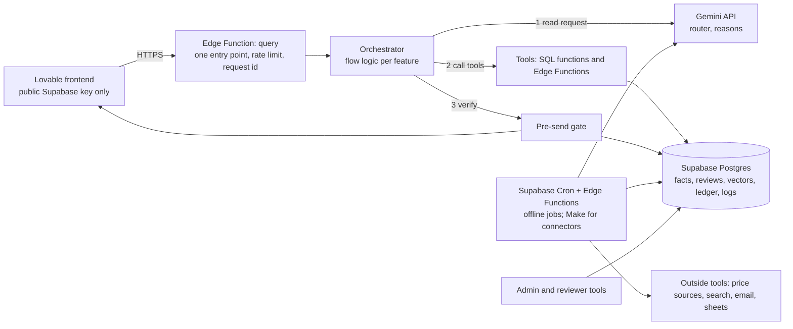

# LapFit: backend build plan

How to build the backend for the prototype, with the data layer first, and where tools and API keys fit. Written for the stack you described: a Lovable frontend, webhooks and tools in the style of your Make.com scenarios, Gemini for language, Supabase for data.

**Decisions made here are logged in `../ai-spec/02_DECISIONS.md` (D-16 to D-22) and the reasoning in `../ai-spec/05_ANSWERS.md` (section 11).** Facts were checked on 13 Nov 2026; sources are in `05_ANSWERS.md`.

---

## 1. The short version

1. **The data layer is the product.** Put everything in one Postgres database (Supabase) and give the AI model *tools* that read it. The model never answers from memory.
2. **You already own a strong dataset.** `prototype_prathyusha/` holds a real database: 14 Indian laptops with prices, 29 laptops in all, about 4,000 reviews, 1,316 machine-extracted owner opinions with exact quotes, specs with provenance and a sources table with permissions. Import it; do not rebuild it. (Decision D-04 is revised: reuse the **data**, not the old code.)
3. **Tools are small, deterministic functions** (SQL functions and Edge Functions) that the orchestrator calls: find laptops, get reviews, check a spec claim, look up a verdict, run the gate. The AI model only reads the request into fields and writes short wording.
4. **Orchestration:** the live request path runs in **Supabase Edge Functions** (code you can test and that must answer within 8 seconds). **Scheduled and offline jobs run on Supabase Cron calling Edge Functions** (price ingestion, review labelling, reports, weekly evaluation, clean-up), which needs no extra tool. **Make.com is kept for connectors** (a sheet, email, an outside service). Section 6 explains why and what I checked.
5. **API keys stay on the server.** The browser holds only the public Supabase key, which is safe because of row-level security. Section 7 lists every key.

---

## 2. What already exists and what it can support

### 2.1 Inventory (counted from the files on 13 Nov 2026)

| Asset | Where | What it holds |
|---|---|---|
| SQLite database | `prototype_prathyusha/backend/data/lapfit.db` (12 MB) | 28 models, 29 variants (14 Flipkart laptops sold in India, 15 evidence-only laptops), 173 spec facts, 12 benchmarks, 10 sources, 3,987 reviews, 1,316 extracted owner opinions, 3,987 embeddings, full-text indexes, 458 duplicate clusters |
| Vote database | `backend/data/votes.db` | 4,514 topic opinions across 2,819 reviews |
| Data pack | `lapfit_data_pack/datasets/` | Raw and processed CSVs (Flipkart, Amazon), curated laptops, benchmarks, evidence gaps, source register |
| Backend code | `backend/lapfit/` | A Python web service with 19 endpoints, 228 tests, local-model scripts |
| Prompts and evals | `backend/prompts/`, `eval/` | Review-extraction prompts, claim and listing evaluation scripts, golden sets |
| Policy | `docs/SOURCE_POLICY.md`, `DATA_AUDIT.md` | What may be fetched and quoted from each site |

### 2.2 Shape of the existing data (what is in the tables)

| Table | Rows | Key fields |
|---|---|---|
| `laptop_models` | 28 | brand, marketing name |
| `laptop_variants` | 29 | id (for example FKL-10), display name, **aliases (JSON)**, set (`flipkart14`, `well_evidenced`), review count |
| `spec_facts` | 173 | variant, attribute, text or number value, unit, **source, exact quote**, how well the source matches the variant (`exact_listing` … `unknown`), **validation status** |
| `reviews` | 3,987 | source, variant, **star rating**, title, text, language, helpful votes, **duplicate cluster**, **injection-like flag**, content hash |
| `evidence_claims` | 1,316 | review, variant, **category (14)**, claim text, **polarity**, strength, **exact quote with start and end**, model and prompt version, validation status |
| `sources` | 10 | publisher, class, licence status, **permission** (`stored_full`, `stored_facts_only`, `link_only`, `blocked`), attribution |
| `embeddings` | 3,987 | 384-number vector per review, from a multilingual sentence model |

### 2.3 What the data can and cannot support, feature by feature

| Feature | Ready from existing data | Missing |
|---|---|---|
| F01 Shortlist | RAM, storage, display size and price for the 14 India laptops; weight for 14; processor for 14; graphics for 8 | **Hinge type, colours, warranty, model year, memory slots (4 of 29), availability.** Filters on these cannot run until they are curated |
| F02 Second opinion, pitch check | Spec facts with provenance for spec claims; 12 benchmarks for a few performance claims; owner opinions by topic with exact quotes | **No claim ledger yet** (needs named approvers). Many laptop-topic pairs will have fewer than 20 opinions, so the honest answer is often "not enough evidence" |
| F03 Used check | Catalog specs and new prices | **No used prices, no OS rules table** |
| F04 Buy for others | Same as F01 | Same as F01 |
| F05 Owner voice | Topic and polarity from the extracted opinions; region from the source (Flipkart = India, Amazon = US) | **No persona (usage context is empty on all 1,316), no months owned, no review dates.** So persona, months and "last 30 days" filters have nothing to filter until new reports arrive |
| F06 Add my experience | Nothing needed | Empty by design; this is how persona, months and dates start to exist |
| F07 Market pulse | Nothing time-based | **No price history (one snapshot dated 2026-11-10), no review dates, no views.** Needs live data, or sample data labelled as such |
| F08 My laptops | Catalog and price | Warranty years missing |
| F09 Sell plan | New prices for the 14; memory-slot flag for 4 | No used prices, no repair quotes: sample assumptions stay |
| F10 Brand insights | Evidence by topic | Demand data does not exist yet; sample data labelled |

**The honest reading:** F01, F02 and F03 can run on real data for 14 Indian laptops once a few missing fields are curated. F05 works only for topic, polarity and region. F07 and F10 need the sample-data mode until real usage exists.

### 2.4 Limits of the existing data (from your own data audit)

- Flipkart reviews are short (median 9 words), 69.6% five-star, India only, with no dates and no variant (listing level only).
- Amazon 2023 reviews are US, older hardware, and have no stated licence.
- **Rights (researched 13 Nov):** the Flipkart record now states **CC BY 4.0** (re-check it, because your audit saw a blank field); the licence is the uploader's, so keep excerpts short and attributed. The Amazon 2023 data has **no licence and is for research use**, so it is never shown publicly.
- The 1,316 opinions were read by a local Llama 3.1 model and are all marked `machine_validated`, **none human-verified**. Your README reports precision 0.88 and recall 0.83 against answer keys that Claude wrote, not people.
- Prices are one snapshot (2026-11-10) parsed from listing titles.

---

## 3. Architecture

Rules of the architecture:
- **One public entry point** (`query`). Everything else is private.
- **The orchestrator decides the order; tools do the work; the model never touches the database.**
- **Every answer carries** `request_id`, `data_version`, `settings_version` (your existing API design already does this, keep it).
- **Rules-only fallback** when the model is down, slow or rate limited.

---

## 4. The data layer

### 4.1 One database, three kinds of tables

| Kind | Tables | Notes |
|---|---|---|
| **Facts** (verified or sample) | `laptop_model`, `variant`, `spec_fact`, `benchmark`, `price_history`, `model_alias`, `source` | From the existing database plus curation |
| **Evidence** | `review`, `evidence_claim` (mapped to `evidence_excerpt` for owner voice), `owner_submission`, `claim_ledger`, `embedding` | Existing reviews and opinions plus new reports |
| **System** | `settings`, `query_log`, `unhandled_request`, `gate_log`, `view_event`, `demand_signal`, `audit_log`, `reviewer` | New |

The full definitions are in `../data-model/DATA_MODEL.md`. Two changes follow from the existing data (decisions D-17 and D-18):

1. **Topic taxonomy: adopt the 14 categories already in the data** (performance, battery, display, build_reliability, thermals_noise, keyboard_trackpad, memory, ports_connectivity, gpu, portability, upgradeability, value, delivery_or_seller, other). Our seven topics become a grouping on top. Reason: 1,316 opinions are already labelled this way; re-labelling costs time and adds risk.

   | Our topic | Existing categories |
   |---|---|
   | battery | battery |
   | keyboard | keyboard_trackpad |
   | hinge (build) | build_reliability |
   | display | display |
   | performance | performance, gpu, memory |
   | heat and noise | thermals_noise |
   | service | delivery_or_seller |

2. **Sentiment: use polarity counts for imported opinions, ratings for new reports.** Imported rows carry polarity (positive, negative, mixed, neutral), not a topic-level score. Showing "62 of 88 owners positive about battery" is more honest than inventing an average. New owner reports keep the 1 to 5 rating. The evidence table gets a nullable `rating` and a `polarity`.

### 4.2 Import plan (SQLite to Postgres)

| Existing | Becomes | How | Check |
|---|---|---|---|
| `laptop_models`, `laptop_variants` | `laptop_model`, `variant` | Copy; build `model_alias` from the aliases JSON; keep the variant ids (FKL-10…) | 29 variants, 28 models |
| `spec_facts` | `spec_fact` (kept as is) plus a **wide view** `variant_specs` for filtering | Keep provenance (source, quote, match, status); pivot ram, storage, display, weight, price, cpu, gpu | 173 rows; wide view has 14 India rows with price |
| `spec_facts` price rows | `price_history` | One row per variant with `retrieved_at` as the as-of date (all 14 are 2026-11-10) | 14 rows |
| `sources` | `source` | Map permission to `quote_allowed` (true only for `stored_full`); keep licence status; add `rights_status` (`confirmed`, `unverified_course_use`) | 10 rows |
| `reviews` | `review` | Copy; keep the duplicate cluster id and the injection-like flag | 3,987; 458 clusters |
| `evidence_claims` | `evidence_claim`, and a view `evidence_excerpt` | Map category to our topics; polarity kept; `n_reports = 1`; **count distinct duplicate clusters, not rows**; region from the source | 1,316 |
| `embeddings` | `embedding` (pgvector, 384 numbers) | Copy for A/B; see 4.4 | 3,987 |
| `votes.db` | `topic_vote` (optional) | Copy for the labelling audit | 4,514 |
| `benchmarks` | `benchmark` | Copy; link to variants and sources | 12 |
| CSV curated files | Curation queue | Compare with the database; fill gaps | — |

Write the import as a repeatable script (SQLite in, Postgres out) with row-count checks, so you can rerun it when the team's data grows. Keep the SQLite file as a read-only archive.

### 4.3 Gaps to curate before the three core features work well

| Field | For | Source of truth | How |
|---|---|---|---|
| Hinge type | F01 filter and the convertible test | Manufacturer page or listing | Manual, 14 laptops |
| Colours | F01 colour note | Retailer or manufacturer listing | Manual |
| Warranty years | F01, F08 | Manufacturer page | Manual |
| Model year | F03 operating-system rule | Manufacturer page | Manual |
| Memory slots, soldered or not | F03, F09 upgrade | Manufacturer page (`ram_upgradeable` exists for 4) | Manual |
| Availability | F01 | Retailer listing | Daily job |
| Weight, display, processor, graphics | Check, fill blanks | `spec_facts` | Review `needs_human_spot_check` rows (13) |
| Used price bands | F03, F09 | Hand-collected public listings (numbers only) or partner | Later |

**Started for you:** `../data-model/curation/catalog_curation_14.csv` already holds, for all 14 laptops, the price and its date, the processor split into vendor, family and generation, the Windows 11 status (from Microsoft's lists: 12 supported, 1 macOS, 1 unknown), the hinge type (assistant knowledge, **unverified**), warranty (1 year, with sources) and memory-slot facts as known. **Colours are optional in version 1** (decision D-29). What is left is verification by a named person. Mark each row verified (`verified_by`).

### 4.4 Retrieval: text search, then vectors

- **Start with Postgres full-text search plus filters** (laptop, category, polarity, region). It is exact, fast and explainable for 4,000 reviews.
- **Add vectors only for semantic matching**: matching a pasted claim to a ledger claim, and finding opinions by meaning. The existing vectors come from a multilingual sentence model (384 numbers). A query is embedded with the **same** model or the numbers cannot be compared.
- **Decision D-19 and D-27 (researched):** re-embed the 3,987 reviews once with **`gemini-embedding-2` at 768 dimensions** ($0.20 per million input tokens, so about $0.05 for roughly 240,000 tokens), keep the old vectors for a side-by-side test, and use `pgvector` in Supabase (supported; filtered searches need iterative index scans). The docs do not name Hindi, Telugu or Tamil, so test those query styles against `gemini-embedding-001` and the old vectors, using the recall test in your `docs/RAG_EVALUATION.md`.
- **Hybrid search**: combine text and vector rank (reciprocal rank fusion), always after the hard filters, and always dedupe by cluster.

### 4.5 Rights and modes

| Mode | Allows | Use |
|---|---|---|
| `course` | Sources marked unverified, labelled "course use only" | Prototype, class demo |
| `production` | Only sources with `rights_status = confirmed` and `quote_allowed = true` for quoted text | Anything public |

One setting switches the mode, and the gate refuses to show quoted text from a source that fails the mode. This keeps the prototype honest and makes launch a switch, not a rebuild.

### 4.5a Source rights (researched 13 Nov 2026)

| Source | Status | What is allowed |
|---|---|---|
| Flipkart review dataset (Zenodo 17612521) | `declared_cc_by_4` | Short excerpts (up to 25 words) with attribution and a link to the record; never republish the dataset; legal review before public launch |
| Amazon Reviews 2023 | `research_only` | Evaluation and embedding tests only; excluded from `production` mode |
| Manufacturer pages | `facts_only` | Short factual values with a link |
| Independent lab pages (for example Notebookcheck) | `facts_only` | Short measurements and a link; quotes up to 25 words with the name |
| Owner reports (F06) | Consented | Shown after approval; deletable by receipt code |

### 4.5b Sample mode

Features that need time or usage (F07, F10, parts of F08 and F09) use **sample rows marked `is_sample`**, always labelled on the response. This is the same rule as before: only verified rows or sample rows are shown.

### 4.6 Security and housekeeping

Row-level security on every table; the public key can read only what the entry point exposes; versioned `data_version` stamped at each import; nightly backup; migrations in files, not clicks.

---

## 5. Tools and how the flows use them

A **tool** is one thing the orchestrator can ask for, with a fixed input and output. This is the same idea as the modules in your Make.com scenario.

| Tool | Kind | Input | Output | Used by | Key needed |
|---|---|---|---|---|---|
| `understand_request` | Model | Message, history, optional image | Router JSON (flow, needs, mentions, claims, filters, tone) | All | Gemini key |
| `resolve_laptop` | SQL function | Brand, line, RAM, storage | Variant, or choices, or not found | F02, F03, F09 | — |
| `find_laptops` | SQL function | Normalised needs | Matching variants, ranked, with Must results | F01, F04, F02 alternatives | — |
| `relax_options` | SQL function | Needs | Up to two relax options with counts | F01 | — |
| `get_specs` | SQL function | Variant | Wide spec row with provenance | F01, F02, F03, F09 | — |
| `get_price` | SQL function | Variant | Price, as-of date, range, seller | F01, F02, F03, F07, F08, F09 | — |
| `get_reviews` | SQL function (text, vector, filters) | Laptop, topic, polarity, region, persona, months, window | Opinions with exact quotes, counts, n | F02, F05, F08 | Embedding key (query) |
| `check_spec_claim` | SQL function / code | Claim, variant(s) | Matches, does not match, or not in catalog, with stored values | F02 | — |
| `lookup_claim_verdict` | SQL function (text now, vector later) | Claim, scope | Approved verdict with approver, or none | F02 | Embedding key (later) |
| `used_listing_rules` | Edge Function | Listing fields, variant | Ordered flags | F03 | — |
| `team_plan` | Edge Function | Roles, budget | One laptop per role and totals | F04 | — |
| `sell_plan` | Edge Function | Condition, variant | Value range, fixes, pricing | F09 | — |
| `trend_snapshot` | SQL view / job | Window | Three lists | F07 | — |
| `brand_views` | SQL views | Brand, model | Aggregates with suppression | F10 | — |
| `write_reasons` | Model | Fact lines | 2 to 3 reasons | F01, F02, F04 | Gemini key |
| `gate_check` | Edge Function | Block | Pass, or reason it failed | All | — |
| `log_event` | SQL insert | Event | — | All | — |
| `web_lookup` (optional) | External API | Laptop name | Official page facts, link-only by policy | Fill catalog gaps | Search key (your existing code uses Tavily) |

**Flow patterns** (the "scenario" for each feature; the order is the orchestrator's code):

| Flow | Steps |
|---|---|
| Shortlist (F01) | `understand_request` → normalise → `find_laptops` → if none `relax_options` → `get_reviews` (rating and n only) → `write_reasons` → `gate_check` → `log_event` |
| Second opinion + pitch (F02) | `understand_request` → `resolve_laptop` → `get_specs`, `get_price`, `get_reviews` → `find_laptops` (alternatives) → for each claim: `check_spec_claim` or `lookup_claim_verdict` → `write_reasons` → `gate_check` |
| Used check (F03) | `understand_request` → `resolve_laptop` → `get_specs`, `get_price` → `used_listing_rules` → `gate_check` |
| Buy for others (F04) | `understand_request` → ask up to two questions → `find_laptops` or `team_plan` → `write_reasons` → `gate_check` |
| Owner voice (F05) | `understand_request` (typed) or filters → `get_reviews` → `gate_check` |
| Sell plan (F09) | `understand_request` or form → `resolve_laptop` → `sell_plan` → `gate_check` |
| Market pulse, My laptops, Brand insights (F07, F08, F10) | Read snapshot or compute → `gate_check` (no model) |

---

## 6. Where Make.com fits (and where it does not)

**What I researched (13 Nov 2026):**
- **Make:** the Free plan has **1,000 credits a month** (official). Third-party pages list **2 active scenarios**, a **15-minute minimum interval** and a **5-minute** execution limit. Make's help says it handles up to **300 incoming webhook requests per 10 seconds**. **I could not find a documented limit for how long a webhook response may take**, so I treat it as unknown.
- **Supabase Cron** (`pg_cron`) runs SQL or calls an Edge Function at **any interval**, and Supabase recommends at most 8 jobs at once and 10 minutes each.
- **Supabase Edge Functions** allow 150 seconds (Free) or 400 seconds (paid) wall clock but only **2 seconds of CPU per request**, so heavy work belongs in database functions, not in the function itself.

| Job | Home | Why |
|---|---|---|
| Live request path (`query`) | **Supabase Edge Function** | 8-second budget; the gate and filters need tests |
| Price ingestion, review labelling, trend snapshots, weekly evaluation, retention clean-up | **Supabase Cron calling Edge Functions** | Free, no second tool, any schedule |
| A sheet, email or an outside service that Supabase cannot reach | **Make.com** | Connectors; one or two scenarios fit the Free plan |
| Keep-alive for a Free Supabase project (it pauses after a week of inactivity) | Make (a daily ping) or upgrade to Pro for the demo | Pro is about $25 a month |

**If you still want Make on the live path for speed of prototyping**, do it this way:
1. Lovable calls **an Edge Function**, not the Make URL, so the webhook address never reaches the browser. The Edge Function forwards the request with a secret header.
2. In Make, the **first module checks the secret header**; anything without it stops.
3. Scenario: Webhook → HTTP (Gemini, the router prompt) → Router (by flow) → HTTP (Supabase tool calls) → HTTP (Gemini, the reasons) → HTTP (`gate_check`) → Webhook response.
4. **Respond early**: send the answer as soon as the gate passes; do logging in later modules.
5. Keep the whole path under 8 seconds and add the same rules-only fallback.
6. Put **only glue** in Make. All filtering, ranking, checking and gating stays in the database and Edge Functions, so the same tests apply.
Treat this as a prototype shortcut, and plan to move the path into Edge Functions before real users arrive.

---

## 7. API keys and secrets

| Key | Where it lives | Who may read it | Used for | Never |
|---|---|---|---|---|
| `GEMINI_API_KEY` | Edge Function secrets (Lovable Cloud Secrets or Supabase secrets); Make connection for offline jobs | Server code only | Router, reasons, labelling, judge | In the browser, in a `VITE_` variable, in logs |
| `SUPABASE_SERVICE_ROLE_KEY` | Edge Function secrets; Make connection for jobs | Server code only | Reads and writes that bypass row-level security | In the browser |
| `SUPABASE_ANON_KEY` and URL | Frontend environment | Public | Calls the entry point; limited by row-level security | — |
| `MAKE_WEBHOOK_URL` and `MAKE_SHARED_SECRET` (only if Make is on the live path) | Edge Function secrets | Server code only | Forwarding requests | In the browser |
| Embedding key (same Gemini key, or another provider's) | Edge Function secrets | Server code only | Query embeddings | In the browser |
| `TAVILY_API_KEY` (or another search provider) | Offline job secrets | Server code only | Optional catalog-gap lookup | In the browser |
| Email or messaging key (V2) | Offline job secrets | Server code only | Alerts | — |
| Admin sign-in (Supabase Auth) | Auth provider | Named people | Reviewer and admin functions | Shared passwords |

**Checked:** Lovable's documentation says its Secrets are for backend values used by Edge Functions and never reach the browser, while anything prefixed `VITE_` is exposed to the browser. For Gemini itself I found only third-party guidance that the pattern is the same; confirm it in Lovable.

Practices: one key per environment (development, production); set a **spending cap or budget alert** on the model account; rotate a key if it is ever pasted into a chat or a file; never log request headers; the gate and logs store no secrets.

---

## 8. Build order

Sizes are relative (S, M, L), not days. Each step has a "done when" test.

| Step | Build | Size | Done when |
|---|---|---|---|
| B0 | Accounts and environments: Supabase project, Lovable project connected, Gemini key as a secret, settings table, a health endpoint | S | The entry point answers `health` and a test call to the model works from the server |
| B1 | Schema and **import** of the existing database; data version stamp; row-count report | M | 29 variants, 173 facts, 3,987 reviews, 1,316 opinions in Postgres; counts equal the SQLite file |
| B2 | **Curation** of the 14 laptops (hinge, colours, warranty, year, slots) with named verifiers | M | Every filter attribute has a verified value for each of the 14 |
| B3 | SQL tools: `resolve_laptop`, `find_laptops`, `relax_options`, `get_specs`, `get_price`, `get_reviews` (text first) with tests | M | Test fixtures pass, including "no match" and the convertible case |
| B4 | Entry point and router; settings; logs; rules-only fallback | M | A free-text request returns structured needs; a model failure returns the fallback |
| B5 | **F01 Shortlist** end to end with the gate | M | The F01 acceptance criteria pass on the 14 real laptops |
| B6 | **F02** second opinion and pitch check; spec-claim tool; claim ledger tables with reviewers | L | Acceptance criteria pass; no verdict shows without an approver |
| B7 | **F03** used check rules and OS table | M | Acceptance criteria pass |
| B8 | Gate coverage for every block type; `gate_log`; hard-metric tests | M | A deliberately wrong block is dropped in every flow |
| B9 | Offline jobs on Supabase Cron and Edge Functions: price refresh, review labelling, retention, weekly evaluation (Make only for connectors) | M | Jobs run on schedule and alert on failure |
| B10 | F04 to F10 backends in the order F05, F06, F09, F04, F07, F08, F10 | L | Each feature's criteria pass |
| B11 | Evaluation harness: golden sets, runs, judge calibration | M | One scored run per core feature, logged |
| B12 | Contract tests with the frontend (see `03_FRONTEND_JOBS_AND_TRIGGERS.md`) | S | The frontend jobs all have a working call |

**Why this order:** each step produces something you can test without the model first (data, tools), then adds the model on top. When a result is wrong, you know whether the data, the tool or the model is at fault.

---

## 9. Testing the backend

| Test | What | Source |
|---|---|---|
| Data tests | Row counts, no orphan references, every price has a date, every shown source has permission | New, based on your import checks |
| Tool tests | Each SQL function against fixtures; boundary cases (exactly 20 reports, exactly 5 reports) | New; port the ideas from your 228 tests |
| Flow tests | Each acceptance criterion in the specs as a test | From `../ai-spec/specs/` |
| Hard-metric tests | A Must violated, an invented value, a verdict without an approver, personal data published: all must be zero | From the specs |
| Model tests | Run the golden sets; log model, prompt version and data version | Your `eval/` structure and `RAG_EVALUATION.md` protocol (freeze each set before scoring) |
| Load and latency | p95 per tool and end to end | New |

---

## 10. Risks and what I decided

| Risk | Decision |
|---|---|
| Rights on the review text | Researched: Flipkart declares CC BY 4.0 (short attributed excerpts, legal review before launch); Amazon is research only and never public (D-20, D-26) |
| Machine-read opinions may be wrong about 1 in 8 calls (your own figure) | Show them as "machine-read, not human-verified"; audit a sample; promote rows to verified by hand (D-21) |
| Free-tier model terms allow product-improvement use | Free tier for sample or public data only; paid tier before real user text (D-14, already decided) |
| Make's response-time limit is undocumented and its Free plan is small | Live path in Edge Functions; scheduled jobs on Supabase Cron; Make for connectors only (D-16) |
| Small catalog (14) makes the shortlist feel thin | Say so honestly; the catalog grows by curation, not by model guessing |
| Dates missing in the reviews | Time-based features use new reports and sample data, labelled |
| Old Python backend does not run on Lovable or Make | Keep as a reference and as a local batch tool; do not deploy it (D-22) |

**What I still could not settle:** Make's webhook response limit (not needed now); the exact gazette text of the data protection rules; hinge types and colours verified on product pages (the CSV has unverified entries); Lovable's own Gemini guidance beyond third-party sources.
