# LapFit architecture diagrams

How to read these: **solid boxes are built and tested** (145 tests, in-memory Postgres, fake model). **Dashed boxes are planned, not built.** "Untested live" means the code exists but has never run against the real service because no key or project was available.

Code lives in `backend/`. The orchestrator is `supabase/functions/_shared/handler.ts`.

---

## 1. The whole system

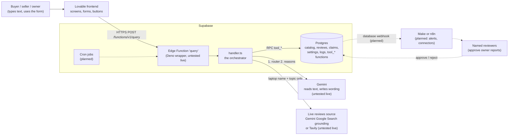

Why the layers are split this way: the model only **reads** text and **words** facts. Facts, filters, prices, counts and the final check are SQL and code, so a model mistake cannot become a wrong price on screen.

---

## 2. What happens after any input (the request lifecycle)

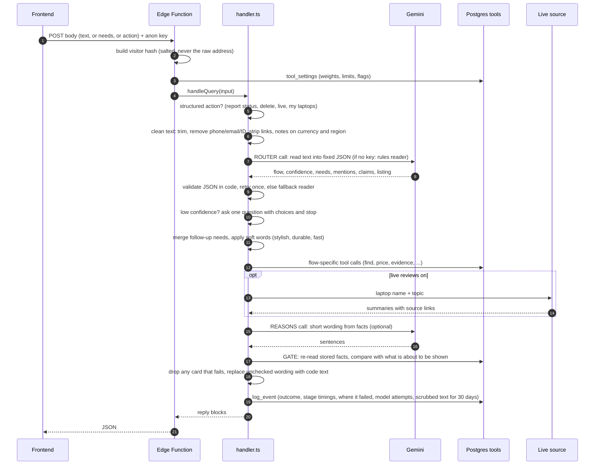

---

### 2b. The rate-limit gate (runs before everything in diagram 2)

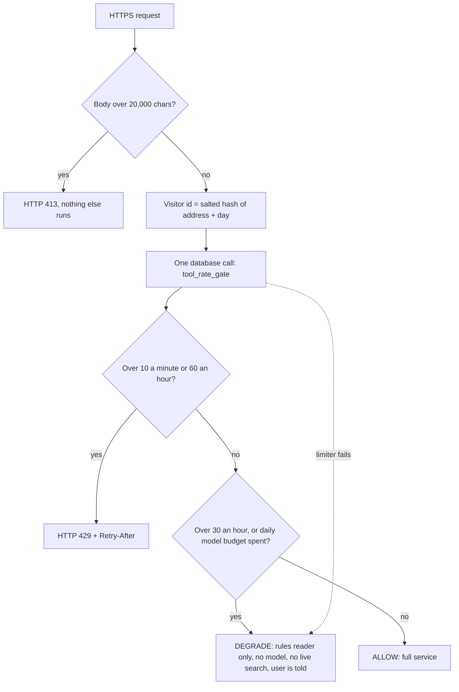

## 3. The decision after the router reads the input

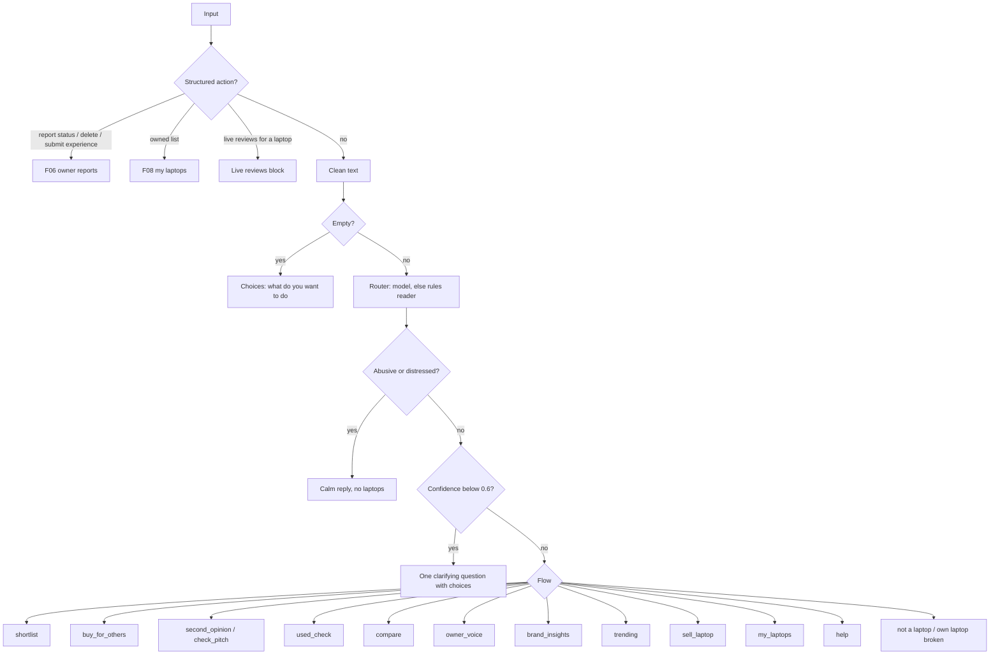

---

## 4. Scenario flows

### 4.1 Shortlist (needs in, laptops out)

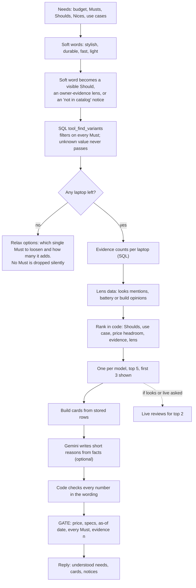

### 4.2 Second opinion and seller pitch check

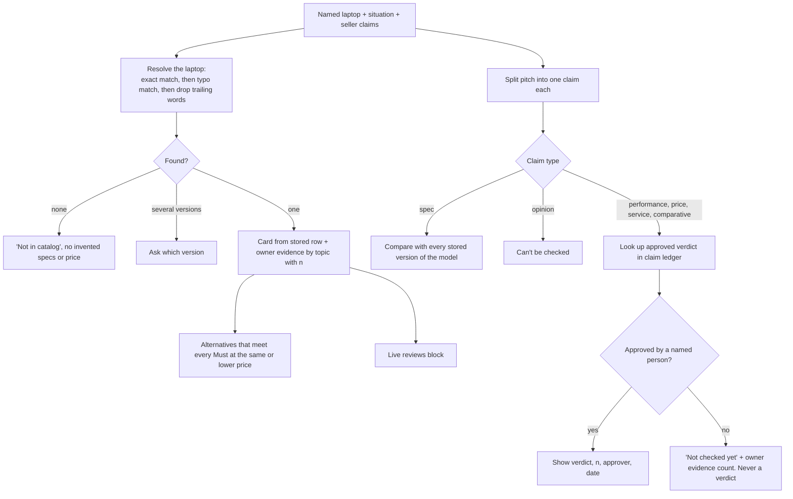

### 4.3 Used laptop check

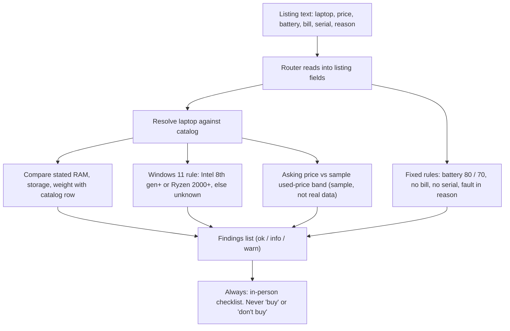

### 4.4 Compare, owner voice, brand insights, market pulse

```mermaid
flowchart TD
  subgraph CMP["Compare two or three laptops"]
    c1["Resolve each (cheapest version if several)"] --> c2["Table of stored values"] --> c3["Mark lower price / weight, higher RAM / storage / battery"] --> c4["Owner evidence per laptop. No overall winner"]
  end
  subgraph OV["Owner voice"]
    o1["Laptop + topic + persona from text"] --> o2["Evidence by topic with n; quotes only if n at least 20 and source allows"]
    o2 --> o3["Persona or months asked? Say the dataset has none"]
    o3 --> o4["Approved owner reports (F06), if any"]
    o4 --> o5["Live reviews, separate block"]
  end
  subgraph BI["Brand insights"]
    b1["SQL brand_stats"] --> b2["Counts, price range, top complaints. n under 20 flagged. No ranking"]
  end
  subgraph MP["Market pulse (no model)"]
    m1["SQL trending: requests, views, price changes"] --> m2["Most reviewed from dataset. Says plainly when no history exists"]
  end
```

### 4.5 Buying for a parent, a child or a team

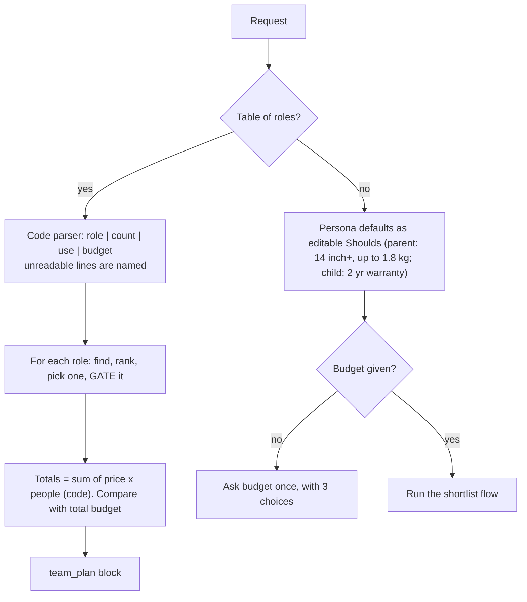

### 4.6 Sell plan and my laptops (rules only)

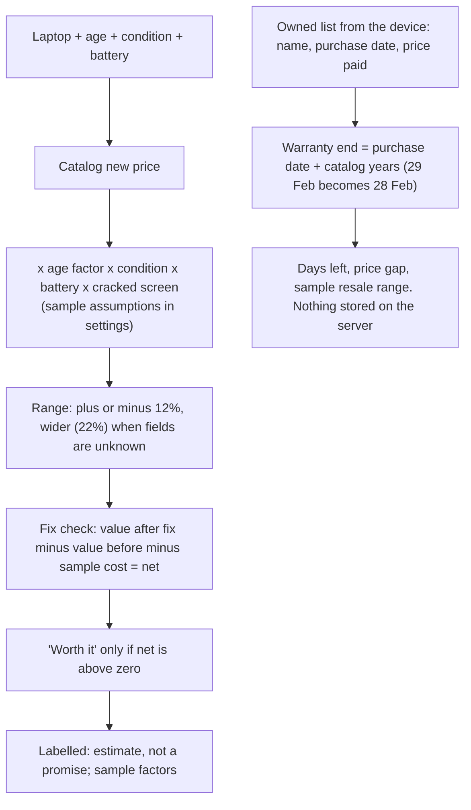

### 4.7 Owner report (F06) with a human in the loop

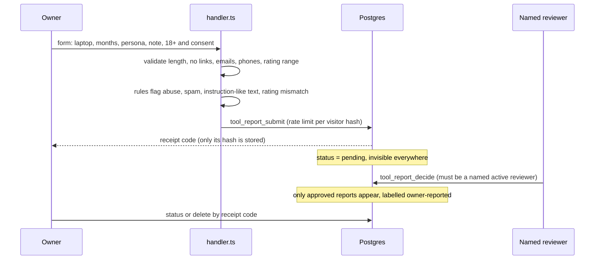

### 4.8 Odd or hostile input

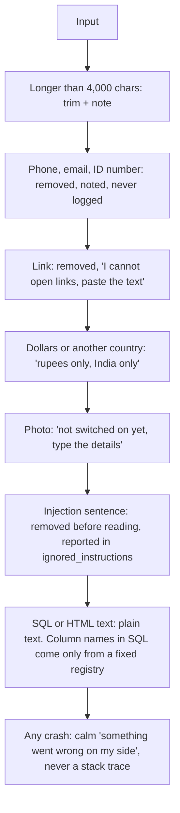

---

## 5. How the AI parts work

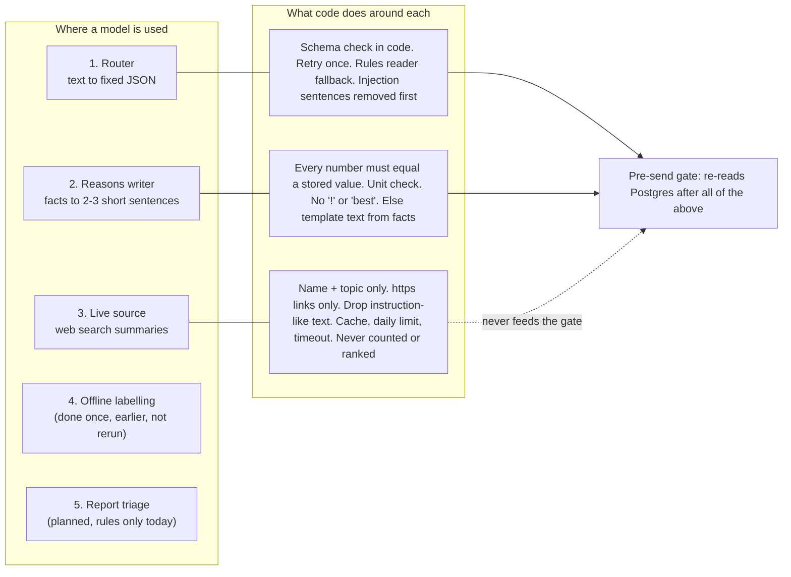

Five-part view of the main AI feature, shortlist:

| Part | In this build |
|---|---|
| Trigger | User text or form posted to the Edge Function |
| Orchestration | `handler.ts`: clean, read, route, flow, wording, gate, log |
| Model | Gemini (router and reasons); rules reader when no key |
| Knowledge | Postgres catalog, dated prices, machine-read owner opinions, claim ledger, live web (separate) |
| Eval loop | 145 automated tests; gate and query logs; golden sets and audits are planned in the AI PRDs |

Gemini note: newer models may ignore a custom temperature, so nothing depends on it. Determinism comes from code checks, retry and fallback.

---

## 6. Live reviews (Gemini grounding or Tavily)

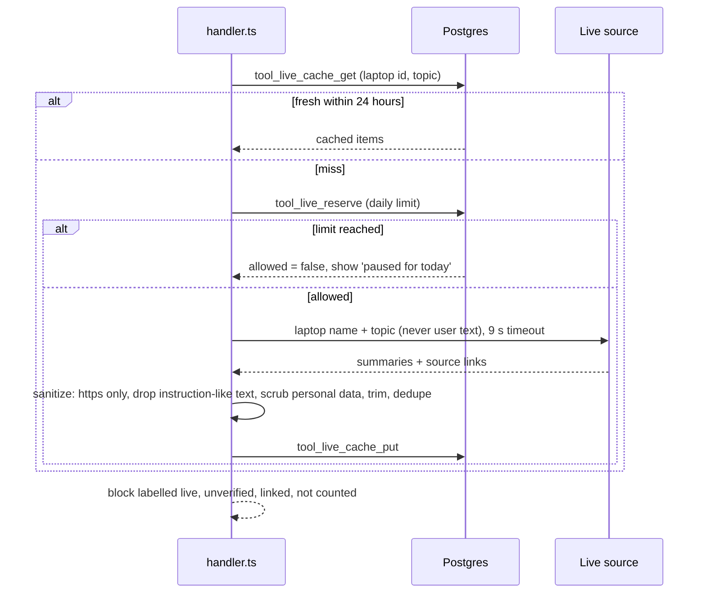

The source is a small interface (`LiveSource.fetch`). Gemini grounding is written. **Tavily would be a second implementation of the same interface**, about 40 lines, not built yet.

---

## 7. Triggers: what starts something

| Trigger | Status | What it starts |
|---|---|---|
| **User HTTPS request** from the frontend | **Built** | `query` Edge Function, flows above |
| **Settings change** (a row in `settings`) | **Built** | Takes effect on the next request; no redeploy |
| **Scheduled (Supabase Cron)** | Planned | Price refresh, nightly cache cleanup, weekly calibration report, batch review labelling |
| **Database event** (new row in `owner_report`) | Planned | Webhook to Make or n8n, then notify the reviewer |
| **Manual admin action** (reviewer approves a report, adds a claim verdict) | **Built** (SQL tools), no admin screen | Changes what users can see |

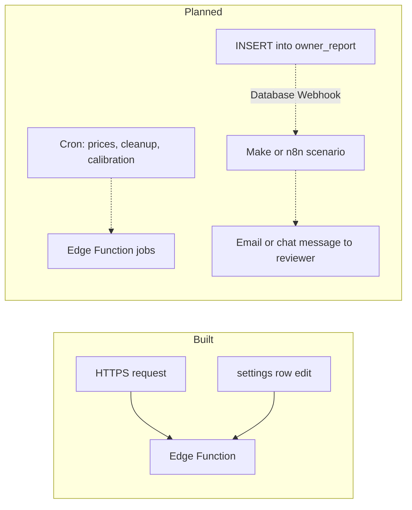

---

## 8. Webhooks: where they are, and why there are none yet

**Built today: no webhooks.** The frontend calls the Edge Function directly and waits for the answer (request and response). That is an ordinary API call. A webhook is different: another system **pushes an event to us** (or we push one to it), and nobody waits.

Nothing in the current scope needs a push:

- No external system sends us events (no payment, courier, email or chat provider is connected).
- The model and live search are called by us, and we wait for them.
- Reviewer notification and scheduled jobs are not built yet.

Where webhooks **would** be used when those parts are built:

| Webhook | Direction | Purpose |
|---|---|---|
| Supabase Database Webhook on `owner_report` insert | Supabase to Make or n8n | Tell a reviewer a report is waiting |
| Alert hook on gate drops or error spikes | Edge Function to Make or n8n | Message the team |
| Reviewer reply link | Make or n8n to Edge Function | Approve or reject from a message |
| Batch labelling finished (if a batch API is used) | Provider to Edge Function | Start the audit; today this would be polling |

## 9. Keys and where they live

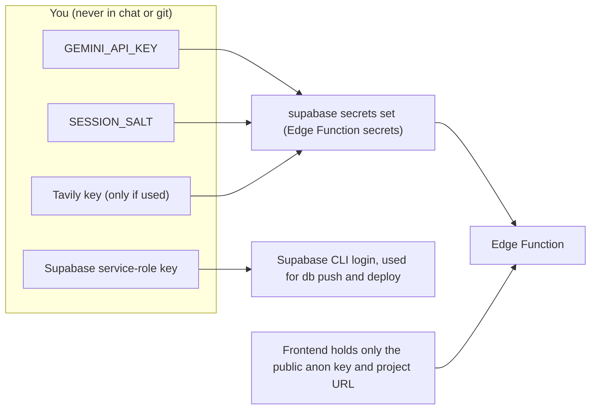

The browser never sees the Gemini, Tavily or service-role keys.

---

## 10. Multimodal: voice and pictures in, voice, picture and message out

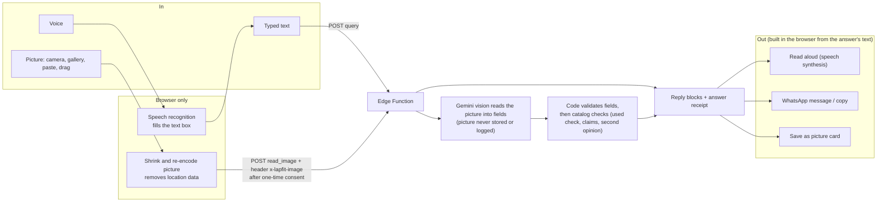

## 11. Where the data in an answer comes from (the receipt)

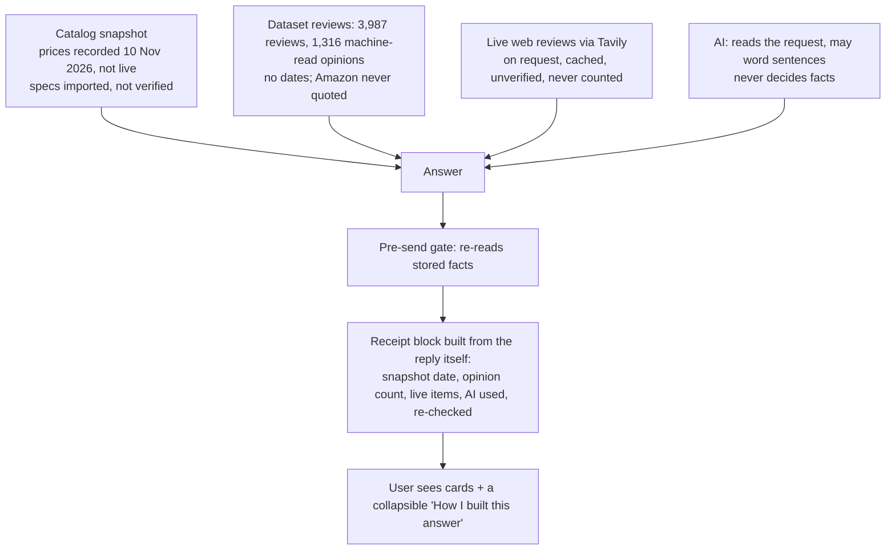

## 12. Shop links and money (and what they cannot touch)

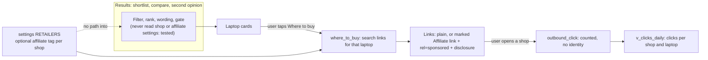
