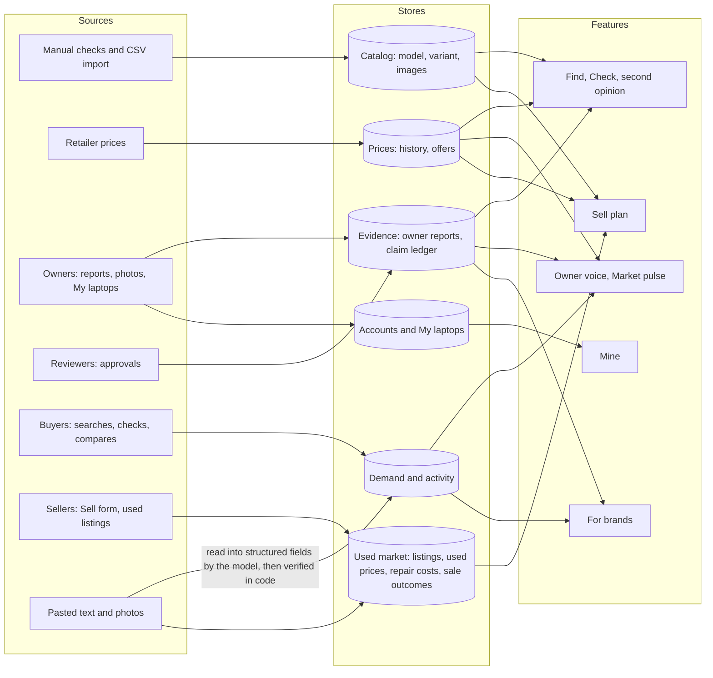
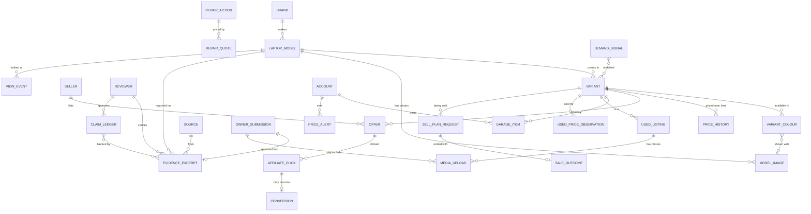

# LapFit data model

Everything LapFit collects, everything it still needs, and what each piece is used for. Includes images.

**Status labels used throughout**

| Label | Meaning |
|---|---|
| **Built** | A table in the prototype database today (`prototype/server/db.js`), filled with SAMPLE data |
| **Needed** | Not built yet, but a use case or revenue stream depends on it |
| **Device** | Lives only in the user's browser in the prototype (`localStorage`) |

**Privacy classes**

| Class | Meaning | Examples |
|---|---|---|
| P0 | Public product facts | specs, prices, colours, product images |
| P1 | Approved community content, no identity | owner reports, claim verdicts |
| P2 | Anonymous behaviour | views, demand signals |
| P3 | Personal or potentially identifying | typed free text, uploaded photos, accounts, what someone owns and paid |

---

## 1. The big picture



**Rule that shapes the whole model:** the AI model reads text or images into structured fields, and writes short wording from facts it is given. Every fact shown (specs, prices, rankings, verdicts, rupee figures) comes from a stored row. If a value is not stored, it is not shown.

---

## 2. Principles that apply to every table

1. **Fact tables carry** `verified`, `verified_by`, `verified_at`, `is_sample`. Only rows that are verified, or marked sample, may be shown.
2. **Prices carry an as-of date.** A price without a date is never shown.
3. **Units are fixed:** money in whole Indian rupees (integer), storage in GB (1 TB = 1024), weight in kg, screen in inches, time in ISO 8601.
4. **Counts travel with claims.** Anything built from owner reports shows `n`. Below the minimum (20) it says "not enough evidence".
5. **Everything has a source.** Where a row came from (a person, a retailer, an import batch) is recorded so it can be audited or removed.
6. **No typed words in analytics.** Demand is stored as budget band, use and Must labels, not the user's sentence.

---

## 3. Entity relationship diagram



---

## 4. Catalog (what a laptop is)

### 4.1 `laptop_model` — Built
One row per laptop line. P0.

| Field | Type | Notes |
|---|---|---|
| id | text, PK | |
| brand | text | Needed: becomes FK to `brand` |
| line | text | Marketing name |
| year | int | Model year. Used by the used-listing check (OS support vs age) |
| processor | text | Free text today. Needed: structured (family, generation, cores) |
| gpu | text | `Integrated` or a named graphics chip |
| display_size | numeric | inches |
| weight_kg | numeric | |
| hinge_type | enum | `clamshell`, `convertible_360`, `detachable` |
| ram_slots_or_soldered | text | Decides if a RAM upgrade can be suggested (looks for "free") |
| warranty | text | Display text, e.g. "2 years" |
| warranty_years | int | For filters and the My laptops countdown |
| verified, verified_by, verified_at, is_sample | | Fact columns |

### 4.2 `variant` — Built
One row per buyable configuration. P0.

| Field | Type | Notes |
|---|---|---|
| id | text, PK | |
| model_id | FK → laptop_model | |
| ram_gb | int | |
| storage_gb | int | |
| colours | JSON array of names | Needed: replaced by `variant_colour` so each colour has a hex and a photo |
| price_inr | int | Current price |
| price_as_of | date | Required whenever a price is shown |
| availability | text | `in_stock`, `limited` |
| fact columns | | |

### 4.3 Needed catalog extras

| Table | Why | Key fields |
|---|---|---|
| `brand` | Brand-level insights, grouping, logos | id, name, country, support_notes, logo_image_id |
| `model_generation` | Selling-timing advice ("a newer model is out") and upgrade advice | model_id, successor_model_id, released_on |
| `variant_colour` | Swatches that match the real product | variant_id, colour_name, hex, image_id |
| `spec_detail` | Extra filterable specs people ask for (touchscreen, backlit keyboard, ports, panel type, battery Wh, charger W). Today these are reported as "cannot check yet" | model_id, key, value, unit, source |
| `processor` / `gpu` lookup | Compare chips and explain them in plain words | id, family, generation, cores, benchmark_ref |

---

## 5. Prices

### 5.1 `price_history` — Built
One row per observed price. P0.

| Field | Notes |
|---|---|
| id, variant_id | |
| seller | Text today. Needed: FK to `seller` |
| price_inr, timestamp | |
| fact columns | |

Used for: price drops, buy-timing, the price chart in For brands, the selling-timing note, resale range base.

### 5.2 Needed: commerce tables

| Table | Fields | Why |
|---|---|---|
| `seller` | id, name, type (marketplace, brand store, shop), verified, url | Who is selling; reliability over time |
| `offer` | id, variant_id, seller_id, price_inr, in_stock, url, seen_at | Live price per seller; the source for `price_history` |
| `affiliate_click` | id, ts, offer_id, session_hash (no identity) | Measures what earns |
| `conversion` | id, click_id, status, commission_inr, confirmed_at | Revenue and which sellers actually deliver |

---

## 6. Owner evidence and trust

### 6.1 `evidence_excerpt` — Built
One row per approved owner report or reviewer excerpt. P1.

| Field | Type | Notes |
|---|---|---|
| id | text, PK | `E…` for imported, `U…` for approved owner submissions |
| laptop_id | FK → laptop_model | |
| topic | enum | `battery`, `keyboard`, `hinge`, `display`, `performance`, `heat_noise`, `service` |
| text | text | Short excerpt (max 300 characters for owner reports) |
| source_name, source_url | text | Where it came from |
| date | date | When written. Drives "last 30 days" |
| reviewer_type | enum | `owner`, `reviewer` |
| persona | enum | `gamer`, `student`, `developer`, `creator`, `parent`, `office` |
| ownership_months | int | How long they had it. Drives "after 6 months" |
| n_reports | int | How many reports this row stands for (1 for a single owner) |
| rating | numeric 1–5 | |
| fact columns | | `verified_by` is the approving person |

Used for: Owner voice, ratings with n, rising complaints, the heatmap for brands, claim evidence summaries.

### 6.2 `owner_submission` — Built
The review queue for "Add my experience". P1 once approved, P3 while pending.

| Field | Notes |
|---|---|
| id, laptop_id, persona, ownership_months, topic, rating, text | As submitted |
| status | `pending`, `approved`, `rejected` |
| submitted_at, reviewed_by, reviewed_at | |
| evidence_id | Set on approval; points to the new `evidence_excerpt` row |

No name, email, phone or IP is stored. Links, emails and phone numbers in the note are rejected.

### 6.3 `claim_ledger` — Built
Person-approved verdicts on non-spec claims. P1.

| Field | Notes |
|---|---|
| id, claim_text, scope | Scope is a laptop line or `general` |
| match_terms | Comma list used to match a seller's wording to this claim |
| verdict | Shown only if an approver exists |
| sample_size | Reports behind the verdict |
| evidence_ids | JSON list of `evidence_excerpt` ids |
| approver, date | A named person |
| fact columns | |

### 6.4 Needed: trust and operations

| Table | Fields | Why |
|---|---|---|
| `reviewer` | id, name, role, active, approved_count | Gives `verified_by` and `approver` real identities and permissions |
| `source` | id, name, url, type, licence, reliability_note | Provenance and permission for every excerpt |
| `import_batch` | id, file, imported_by, imported_at, row_count, status | Undo a bad import |
| `claim_log` | id, ts, laptop_id, claim_type, status (supported, contradicts, not checked…) | Anonymous record of what sellers claim most and how often specs are contradicted ("pitch fingerprints") |

---

## 7. Activity and demand

### 7.1 `view_event` (table `view_events`) — Built
P2. Which laptops people looked at.

| Field | Notes |
|---|---|
| id, ts, laptop_id | |
| kind | `view` today. Needed: `compare`, `owner_voice`, `sell` |
| is_sample | |

Used for: Most checked, checks per week.
Needed: `session_hash` (rotating, not linked to a person) so "people who looked at X also looked at Y" can be built.

### 7.2 `demand_signal` — Built
P2. What buyers ask for, never the typed words.

| Field | Notes |
|---|---|
| id, ts | |
| budget_band | `Under ₹40,000`, `₹40,000 to ₹60,000`, `₹60,000 to ₹80,000`, `₹80,000 and above`, `No budget given` |
| use_cases | JSON, up to 3 (study, coding…) |
| musts | JSON, up to 5 labels (e.g. "RAM 16 GB or more") |
| matched | How many variants satisfied every Must. **0 means unmet demand** |
| is_sample | |

Used for: unmet-demand map, brand insights, catalog priorities.

### 7.3 `query_log` — Built
P2. One row per request, for health and quality, with no text.

| Field | Notes |
|---|---|
| id, ts, flow, confidence, language | |
| router_mode | `model`, `offline`, `form`, `chips`, `filters` |
| duration_ms, outcome, text_len | |

### 7.4 `unhandled_requests` — Built
**P3. Contains typed text.** Requests the app could not handle, so new scenarios can be added.

| Field | Notes |
|---|---|
| id, text, guessed_flow, reason, ts | `reason`: `clarify`, `low_confidence`, `out_of_scope_laptop`, `not_laptop`, `tone:…`, `router_error:…` |

Needs a retention limit and personal-detail scrubbing before launch (see section 12).

### 7.5 `gate_log` — Built
P2. Every card or block the pre-send check dropped or changed.

| Field | Notes |
|---|---|
| id, ts, laptop_id, variant_id | |
| check_name | e.g. `must_failed`, `price_mismatch`, `reasons_replaced`, `owner_voice_mismatch`, `sell_plan_mismatch` |
| detail | |

Used as the quality signal: how often the model-written wording or any figure failed a check.

---

## 8. Selling and the used market

### 8.1 `resale_action` — Built (SAMPLE costs)
Cost of each fix the Sell plan can recommend.

| Field | Notes |
|---|---|
| id | `os_clean`, `gather_docs`, `clean_cosmetic`, `replace_battery`, `fix_keyboard`, `replace_screen`, `ram_upgrade` |
| label, note | |
| cost_low, cost_high | Rupees. Sample estimates, not quotes |
| fact columns | |

### 8.2 Resale assumptions — Built (in `settings.js`, SAMPLE)
Age curve, body, screen, battery, keyboard, bill-and-box, warranty and software factors, range width, and the minimum net gain. These must be replaced by values learned from `used_price_observation` and `sale_outcome`.

### 8.3 Sell plan inputs (`seller_info`, not stored today)
The condition fields the Sell flow reads. They are the data model for a stored request.

| Field | Values |
|---|---|
| variant_id | catalog variant |
| months_owned | integer, unknown allowed |
| body | `like_new`, `good`, `scratched`, `damaged` |
| screen | `perfect`, `marks`, `cracked` |
| battery_pct | 0–100 |
| keyboard_ok | true, false |
| docs | `bill_box`, `bill`, `none` |
| warranty_months | integer |
| os | `fresh`, `cluttered` |
| reason | `upgrade`, `need_money`, `not_using`, `issue`, `gift`, `other` |
| urgency | `quick`, `best_price` |

### 8.4 Needed: used-market tables

| Table | Fields | Why |
|---|---|---|
| `sell_plan_request` | id, ts, variant_id, the condition fields above, today_low/mid/high, fixes_recommended (JSON), account_id (optional) | Calibrates the plan; shows which fixes people actually need |
| `sale_outcome` | id, request_id, sold (bool), sold_price_inr, days_to_sell, channel, fixes_done (JSON), reported_at | **The most valuable seller-side data.** Turns sample assumptions into real ones |
| `used_listing` | id, variant_id, listed_price_inr, stated_specs (JSON), os, battery_pct, has_serial, flags (JSON), source, seen_at | Pasted or imported listings checked by the used-listing flow |
| `used_price_observation` | id, variant_id, price_inr, condition_grade, age_months, channel, observed_at, source | Real used prices, replacing the sample band |
| `repair_action` / `repair_quote` | action_id, brand, region, quote_inr, source, quoted_at | Real repair costs, replacing `resale_action` sample costs |
| `used_flag_stats` | flag_type, count, period | How often listings miss battery health or a serial number, or are priced far from the range |

---

## 9. Users and My laptops

### 9.1 My laptops — Device (prototype)
Saved in the browser under `lapfit.garage`. Nothing is sent to a server except the list, to calculate the summary, and it is not stored there.

| Field | Notes |
|---|---|
| variant_id | |
| bought_on | date |
| paid_inr | optional |

Calculated and not stored: months owned, warranty end and days left, price now vs paid, rough resale range, rating with n, rising complaints.

### 9.2 Needed: accounts (only if people opt in)

| Table | Fields | Why |
|---|---|---|
| `account` | id, contact (phone or email, hashed or encrypted), created_at, consent_version | Sync across devices, alerts. Optional |
| `garage_item` | id, account_id, variant_id, bought_on, paid_inr, serial_hash (optional) | Warranty reminders, report prompts at 1, 6 and 12 months |
| `price_alert` | id, account_id, variant_id, target_inr, channel | Price-drop alerts |
| `saved_search` | id, account_id, needs (JSON: budget band, use, Musts) | Return visits, "new match" alerts |
| `consent_log` | id, account_id, purpose, granted, ts | What each person agreed to |

---

## 10. Images and media

LapFit handles two groups of images: **product images we show**, and **images people give us**. The prototype shows a placeholder icon for every laptop and sends an uploaded photo to the AI model for reading without storing it. A real build needs the tables below.

### 10.1 Image kinds

| Kind | Direction | Used for | Privacy | Status |
|---|---|---|---|---|
| Product hero photo | We show | Card photo | P0 (licence needed) | Needed (placeholder today) |
| Angle photos (open, side, ports, keyboard, underside) | We show | Specs, hinge type, port checks | P0 (licence needed) | Needed |
| Colour swatch or colour photo | We show | Colour chips that match the real product | P0 | Needed (CSS colour guesses today) |
| Brand logo | We show | Brand pages | P0 (licence needed) | Needed |
| Seller pitch photo or screenshot | We receive | Read claims from a photo of a spec sheet, ad or chat | P3 | Prototype: read by the model, **not stored** |
| Used listing screenshot | We receive | Read model, price, specs and missing items | P3 | Prototype: read by the model, **not stored** |
| Battery report screenshot | We receive | Battery health for Sell and used checks | P3 | Needed |
| Serial or model sticker photo | We receive | Confirm model and variant | P3 (serial numbers are identifying) | Needed |
| Condition photos (body, screen, keyboard) | We receive | Judge body and screen condition for Sell | P3 | Needed |
| Owner report photos (e.g. hinge wear, swelling battery) | We receive | Evidence attached to an owner report | P3 until approved | Needed |
| Sell listing photos | We help create | Photo checklist and, later, marketplace listings | P3 | Needed |

### 10.2 `model_image` — Needed
Approved product images. P0.

| Field | Type | Notes |
|---|---|---|
| id | text, PK | |
| model_id | FK → laptop_model | Required |
| variant_id | FK → variant, nullable | Set when the image is specific to a version |
| kind | enum | `hero`, `open`, `side`, `ports`, `keyboard`, `underside`, `swatch`, `box` |
| colour_name | text, nullable | Links to `variant_colour` |
| storage_key | text | Object-storage path; the database holds the pointer, not the file |
| url | text | Public delivery URL |
| width, height, bytes | int | |
| format | enum | `jpeg`, `webp`, `png` |
| alt_text | text | Required, for accessibility |
| source_name, source_url | text | Where the image came from |
| licence | enum | `owned`, `licensed`, `press_kit`, `creative_commons`, `unknown` |
| licence_note, licence_expires | text, date | |
| sha256, perceptual_hash | text | Exact and near-duplicate detection |
| sort_order | int | |
| fact columns | | An unverified or unlicensed image is never shown |

### 10.3 `variant_colour` — Needed

| Field | Notes |
|---|---|
| variant_id, colour_name | |
| hex | Used for the swatch circle |
| image_id | FK → model_image, the photo of that colour |

### 10.4 `media_upload` — Needed
Anything a person gives us. **P3. Raw files are short-lived.**

| Field | Type | Notes |
|---|---|---|
| id | text, PK | |
| purpose | enum | `pitch`, `used_listing`, `battery_report`, `serial_sticker`, `condition`, `owner_report`, `sell_listing` |
| linked_type, linked_id | text | What it belongs to (`owner_submission`, `used_listing`, `sell_plan_request`) |
| storage_key | text | Private bucket, never public |
| format, width, height, bytes | | Resized to a maximum of 1280 px on the long side, JPEG quality about 0.82 (as the prototype already does) |
| sha256 | text | Dedupe |
| exif_stripped | bool | Location and device data removed on upload |
| consent_id | FK → consent_log | What the person agreed to |
| extracted | JSON | What the model read from the image: fields with `source_text` or a region, plus confidence |
| extraction_verified | bool | Whether code or a person checked the extracted values |
| pii_flags | JSON | Faces, phone numbers, addresses, full serial numbers found |
| moderation_status | enum | `pending`, `approved`, `rejected` (owner report photos only) |
| retention_until | timestamp | Raw file deleted after this date; extracted fields can stay |
| created_at | timestamp | |

### 10.5 How images are processed

1. **Receive:** accept JPEG, PNG, WebP up to a set size; resize on the device before upload (the prototype already resizes to 1280 px).
2. **Clean:** strip EXIF and location; compute `sha256`.
3. **Read:** the model reads the image into structured fields (model name, price, specs, battery %, serial present or not), each with the text or region it came from. Same rule as text: the model never supplies a fact.
4. **Verify in code:** extracted values are matched to the catalog. Anything that does not match is shown as "could not read" or "not in catalog", never guessed. If an image is blurry, the answer says exactly what could not be read and asks for the model name typed.
5. **Protect:** blur or flag serial numbers, faces and personal details. Owner report photos are shown only after a person approves them.
6. **Retain:** delete the raw upload after its retention date. Keep the extracted fields only if the person allowed it.
7. **Show:** product images are shown with their alt text. Where no approved image exists, the placeholder stays.

---

## 11. Model and quality data

| Table | Status | Fields | Why |
|---|---|---|---|
| `query_log` | Built | see 7.3 | Speed, flow mix, fallbacks |
| `gate_log` | Built | see 7.5 | How often a check caught something |
| `model_call_log` | Needed | id, ts, call_type (router, reasons), model, latency_ms, schema_valid, retries, tokens_in, tokens_out | Cost and reliability; no user text |
| `eval_case` | Needed | id, input_kind (text, image), input_ref, expected_flow, expected_fields (JSON), expected_blocks | A fixed test set so every change can be scored (the team's golden dataset can feed this) |
| `eval_run` | Needed | id, ts, model, settings_version, pass_rate, details | Track quality over time |
| `settings_version` | Needed | id, ts, values (JSON) | Which thresholds were live when a result was produced |

---

## 12. Privacy, retention and gaps to fix

| Data | Class | Keep for | Notes |
|---|---|---|---|
| Catalog, prices, product images | P0 | Indefinitely | Licence must be confirmed per image and per price source |
| Approved owner reports, claim verdicts | P1 | Indefinitely | Delete on request through the submission id |
| `view_event`, `demand_signal`, `query_log`, `gate_log` | P2 | 24 months, then aggregate | No identity, no typed words |
| `unhandled_requests.text` | **P3** | 90 days | **Gap:** stores typed text today. Scrub phone numbers, emails and names, then keep only the category after 90 days |
| `owner_submission` (pending) | P3 | Until reviewed, then 30 days if rejected | Nothing identifying is collected |
| `media_upload` raw files | P3 | 30 days (set per purpose) | Private storage, EXIF stripped |
| My laptops (Device) | P3 | On the user's device | **Gap:** moving to an account needs consent and encryption |
| `account`, `garage_item`, alerts | P3 | While the account exists | Hash or encrypt contacts; deletion on request |

**Other gaps**
- The sample resale factors and repair costs are assumptions. Real `used_price_observation`, `sale_outcome` and `repair_quote` data should replace them.
- Product images and scraped prices need permission from the source. Record licence and source on every row.
- The catalog stores processor and graphics as free text, so those cannot be compared or filtered properly yet.
- Many specs people ask for (touchscreen, ports, backlit keyboard) are not stored, so those Musts are reported as "cannot be checked yet".

---

## 13. Reference values (enumerations in use)

| Name | Values |
|---|---|
| hinge_type | `clamshell`, `convertible_360`, `detachable` |
| persona | `gamer`, `student`, `developer`, `creator`, `parent`, `office` |
| topic | `battery`, `keyboard`, `hinge`, `display`, `performance`, `heat_noise`, `service` |
| reviewer_type | `owner`, `reviewer` |
| availability | `in_stock`, `limited` |
| router flow | `second_opinion`, `check_pitch`, `shortlist`, `used_check`, `buy_for_others`, `owner_voice`, `trending`, `sell_laptop`, `clarify`, `out_of_scope_laptop`, `not_laptop` |
| claim type | `spec`, `performance`, `price`, `service`, `comparative`, `absolute`, `opinion` |
| claim result | Matches the catalog, Does not match the specs, Not in catalog, Checked by a person, Not checked yet, Can't be checked |
| must operators | `>=`, `<=`, `=`, `>`, `<`, `in` |
| must attributes | `ram_gb`, `storage_gb`, `weight_kg`, `price_inr`, `display_size`, `warranty_years`, `year`, `hinge_type`, `colour` |
| submission status | `pending`, `approved`, `rejected` |
| rising complaint | A report rated 3.0 or below; at least 5 recent reports and more than the window before |
| settings (one file) | Minimum n 20; model timeout 8 s; router confidence 0.6; trend window 30 days; price-drop minimum 3%; minimum net gain from a fix ₹500 |

---

## 14. Which data each use case needs

| Use case | Built tables used | Needed to make it real |
|---|---|---|
| Second opinion | laptop_model, variant, price_history, evidence_excerpt | model_image, offer |
| Check a seller pitch | laptop_model, variant, claim_ledger, evidence_excerpt | claim_log, media_upload (pitch photos), reviewer |
| Shortlist / Find | laptop_model, variant, evidence_excerpt, demand_signal | spec_detail, variant_colour, model_image |
| Used listing check | laptop_model, variant | used_listing, used_price_observation, used_flag_stats, media_upload |
| Buy for others | laptop_model, variant | account (team saves), spec_detail |
| Owner voice | evidence_excerpt, owner_submission | source, reviewer, media_upload (owner photos) |
| Market pulse | view_event, evidence_excerpt, price_history | offer, session_hash |
| My laptops | variant, laptop_model, evidence_excerpt | account, garage_item, price_alert, consent_log |
| Sell my laptop | variant, price_history, resale_action, view_event | sell_plan_request, sale_outcome, used_price_observation, repair_quote, media_upload |
| For brands | evidence_excerpt, price_history, demand_signal, view_event | brand, claim_log, source |
| Affiliate and other revenue | none | seller, offer, affiliate_click, conversion |

---

## 15. What to collect first

1. **Verified catalog** for the most searched real laptops: models, variants, specs, warranty, and the memory-slot detail.
2. **Prices with dates** from a small set of sellers, and a daily job that adds to `price_history`.
3. **Product images** (hero, ports, colour) with a recorded licence, so cards stop showing placeholders.
4. **A seed of owner reports** with persona and months owned, from sources you have permission to use, plus the "Add my experience" queue to keep it growing.
5. **Real used prices and repair quotes**, so the Sell plan stops running on assumptions.
6. **Sale outcomes** from people who used the Sell plan, to measure whether the advice worked.
7. **Accounts and alerts** last, once there is a reason for people to come back.

---

## 16. Additions from the JTBD analysis (Needed)

From `../jtbd-analysis/JTBD_EXPANSION.md`. Each entity exists because a specific job needs it. None is built.

| Table | Job it serves | Key fields | Privacy |
|---|---|---|---|
| `symptom_report` | "Is this normal?" after buying | model_id, symptom (fixed list), started_after_months, severity, resolved, fix_note | P1 once approved |
| `service_centre`, `service_visit` | What to say and expect at service; service experience before buying | brand, city, turnaround_days, cost_inr, outcome, rating | P1 |
| `shared_list`, `shared_list_member` | Agree a choice with family or a team | list_id, member_ref, musts, shortlisted_variant_ids, decision | P3 |
| `organisation`, `org_member`, `org_asset` | Team and college buying, asset register, refresh planning | org_id, role, variant_id, assigned_on, warranty_end, approval_ref | P3 |
| `part_compatibility` | Upgrade or replace | model_id, part_type, spec, max_supported, notes | P0 |
| `seller_score` | Choose who to buy from; verified seller | seller_id, claims_checked, contradicted_share, conversion_reliability | P1 |
| `alert` (extends `price_alert`) | Price drops and sale checks on saved needs | needs (JSON) or variant_id, trigger, channel | P3 |
| `event_calendar` | Sales, launches, college start | event, start, end, source | P0 |

Also note: `unhandled_requests` already collects the jobs the app cannot do yet (for example "my laptop is slow"). Review it monthly; it is the cheapest source of new jobs.

---

## Appendix A. Postgres DDL for the media tables (Needed)

```sql
create table model_image (
  id text primary key,
  model_id text not null references laptop_model(id),
  variant_id text references variant(id),
  kind text not null check (kind in ('hero','open','side','ports','keyboard','underside','swatch','box')),
  colour_name text,
  storage_key text not null,
  url text not null,
  width int, height int, bytes int,
  format text check (format in ('jpeg','webp','png')),
  alt_text text not null,
  source_name text, source_url text,
  licence text not null check (licence in ('owned','licensed','press_kit','creative_commons','unknown')),
  licence_note text, licence_expires date,
  sha256 text, perceptual_hash text,
  sort_order int default 0,
  verified boolean not null default false, verified_by text, verified_at timestamptz,
  is_sample boolean not null default false
);

create table variant_colour (
  variant_id text not null references variant(id),
  colour_name text not null,
  hex text not null,
  image_id text references model_image(id),
  primary key (variant_id, colour_name)
);

create table media_upload (
  id text primary key,
  purpose text not null check (purpose in ('pitch','used_listing','battery_report','serial_sticker','condition','owner_report','sell_listing')),
  linked_type text, linked_id text,
  storage_key text not null,
  format text, width int, height int, bytes int,
  sha256 text,
  exif_stripped boolean not null default false,
  consent_id text,
  extracted jsonb,
  extraction_verified boolean not null default false,
  pii_flags jsonb,
  moderation_status text check (moderation_status in ('pending','approved','rejected')),
  retention_until timestamptz not null,
  created_at timestamptz not null default now()
);
```
