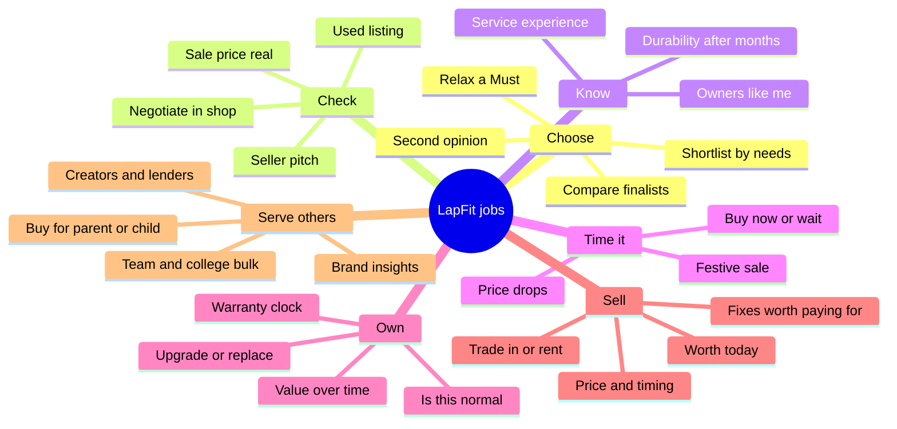

# LapFit: JTBD expansion and product opportunity discovery

Applies the "JTBD Expansion & Product Opportunity Discovery" master prompt to LapFit. Grounded in the prototype (`prototype/`) and the data model (`data-model/DATA_MODEL.md`).

## How to read this

| Tag | Meaning |
|---|---|
| **[F]** Fact | True of the prototype or the data model today |
| **[A]** Assumption | Reasonable but not verified; stated so you can challenge it |
| **[H]** Hypothesis | A claim that needs user research. All scores below are hypotheses |

| Prototype status | Meaning |
|---|---|
| **Built** | Works in the prototype, on sample data |
| **Partial** | Some of it exists |
| **Not built** | Idea only |

**Inputs I assumed** (nothing critical was missing, so I proceeded):
- **Product idea:** LapFit, a laptop second-opinion and recommendation web app for buyers in India. [F]
- **Target users:** laptop buyers, owners and sellers in India; later, brands and retailers. [F/A]
- **Core problem:** buyers get biased or inconsistent advice from sellers, listings and videos, and cannot tell what is true. [A]
- **Existing capabilities:** verified-catalog structure, dated prices, owner reports by user type and months owned, a person-approved claim ledger, buyer-demand signals, a sell plan, and a rule that the AI model never supplies a fact. All on **sample** data. [F]

**Limits.** No user research was done for this document. Competitor knowledge is general. Real data, real users and real sales do not exist yet.

---

## 1. Core product purpose and original JTBD

**Core job statement**

> When I am about to spend a large part of my budget on a laptop, and everyone advising me (seller, listing, video, friend) has an angle, I want to check independently whether a specific laptop fits my needs and whether what I have been told is true, so I can buy once, at a fair price, and not regret it.

| Dimension | Answer |
|---|---|
| **Functional job** | Choose a laptop that fits my needs and budget, and verify claims made about it. |
| **Emotional job** | Feel confident, not fooled. Reduce the fear of being cheated and the regret afterwards. [A] |
| **Social job** | Look informed in front of the shopkeeper. Justify the choice to a spouse, parent, manager or finance team. When buying for someone, show care. [A] |
| **Circumstances** [A] | A student starts college; a job change; an old laptop fails; a festive sale; a parent asks for help; a company onboards staff. |
| **Current alternatives** [A] | The shopkeeper or salesperson; a friend who "knows computers"; YouTube reviewers; Reddit and WhatsApp groups; Amazon and Flipkart reviews; spec aggregators such as Smartprix and 91mobiles; general AI chatbots. |
| **Desired outcome** [H] | No spec surprises; paid a fair price; still happy after 6 to 12 months; decision made in a reasonable time. |
| **How users measure success** [H] | "I did not get cheated." "It does what I needed." "I would recommend it." "I did not have to ask five people." |

**Where the prototype stands** [F]: the original job is covered by Find, Check, second opinion and Owners. What the product has already grown into: owning (Mine), selling (Sell), market timing, and a brand-facing view.

---

## 2. User segments and their desired outcomes

| # | Segment | Desired outcome | Key difference |
|---|---|---|---|
| S1 | First-time buyer or student, and their parents | A laptop that lasts the course within a tight budget, bought without being cheated | Low knowledge, high anxiety, parents often decide |
| S2 | Performance seeker (gamer, creator, developer) | Heat, noise, battery and performance that hold up over months | Trusts peers of the same kind more than specs |
| S3 | Working professional | A reliable work machine with minimal hassle | Time-poor, warranty and service matter |
| S4 | Buying for someone else (parent, child, gift) | Something simple they will actually use | Is not the user; proxies for the user |
| S5 | Used and refurbished buyer | A fair price without hidden problems | Cannot inspect over a listing |
| S6 | Seller or upgrader | The most money, with the least effort and risk | Needs timing, preparation and pricing |
| S7 | Current owner | Warranty, support, to know if a problem is normal, and when to replace | Long relationship after purchase |
| S8 | Small business, school or college buying in bulk | Right laptop per role within a total budget, with a record of why | Group decision; accountability |
| S9 | Brands, retailers, refurbishers (B2B) | Know what buyers want, what owners complain about, where prices sit | Pay for insight |
| S10 | Reviewers and creators (supply side) | Accurate specs and audience demand | Could feed and amplify the data |
| S11 | Lenders and EMI partners (B2B) | Resale value curves to price risk | Data buyer |

---

## 3. Complete JTBD expansion map

---

## 4. Categorised list of concrete jobs

Format: *When [situation], I want to [action], so I can [outcome]*, shortened. Status is the prototype's.

### 4.1 Core jobs
| ID | Job | Status |
|---|---|---|
| J1 | When I know my budget and use, I want a shortlist that meets every must-have, so I can stop searching. | Built (Find, shortlist) |
| J2 | When I am looking at one specific laptop, I want a second opinion against my needs, so I can decide. | Built |
| J3 | When a seller makes claims, I want each one checked, so I know what is true. | Built (Check) |
| J4 | When I find a used listing, I want it checked for what does not add up, so I avoid a bad buy. | Built |

### 4.2 Related jobs
| ID | Job | Status |
|---|---|---|
| J5 | I want to know what owners like me report, after months of use. | Built (Owners) |
| J6 | I want to compare two to four finalists on what matters to me. | Built (compare drawer) |
| J7 | I want to know the real price and whether it is a good time to buy. | Partial (price history, Market) |
| J8 | I want to buy for a parent, child or team with minimal questions. | Built |

### 4.3 Adjacent jobs
| ID | Job | Status |
|---|---|---|
| J9 | When I want to sell my laptop, I want to know what it is worth and what to fix, so I get more. | Built (Sell, sample assumptions) |
| J10 | Before replacing, I want to know whether adding RAM or storage is enough. | Partial (Sell checks free slots) |
| J11 | I want to know whether renting beats buying for my need. | Not built |
| J12 | I want a trade-in value so I can upgrade. | Partial (Sell range) |
| J13 | I want to buy refurbished with confidence. | Partial (used check) |
| J14 | I want to equip a team or class within a budget. | Partial (team table) |
| J15 | As a brand, I want to know what buyers want that nobody sells. | Partial (For brands) |

### 4.4 Upstream jobs
| ID | Job | Status |
|---|---|---|
| J16 | I want to work out what I actually need from how I will use it. | Partial (use pills in Find) |
| J17 | I want to understand what my budget can and cannot buy. | Partial (relax suggestions) |
| J18 | I want jargon explained in my language. | Partial (reasons in user's language, jargon-free wording) |
| J19 | I want to know when new models and sales are coming. | Not built |

### 4.5 Downstream jobs
| ID | Job | Status |
|---|---|---|
| J20 | When the box arrives, I want to confirm I got the variant I paid for. | Not built |
| J21 | I want my bill and warranty kept and registered. | Partial (Mine warranty clock) |
| J22 | I want to keep the battery and laptop healthy. | Not built (out of scope today) |
| J23 | Within the return window, I want to decide whether to keep it. | Not built |
| J24 | I want to know when to upgrade or sell. | Partial (Mine, Sell timing) |

### 4.6 Supporting jobs
| ID | Job | Status |
|---|---|---|
| J25 | I want to share a shortlist with family. | Not built |
| J26 | I want to save and revisit options. | Not built (My laptops is for owned ones) |
| J27 | I want a seller's wording translated to plain facts. | Built (claims split) |
| J28 | I want the exact variant to ask for in the shop. | Partial (variant labels) |
| J29 | I want the total cost: EMI, accessories, warranty. | Not built |

### 4.7 Discovery jobs
| ID | Job | Status |
|---|---|---|
| J30 | I want to find laptops I did not know about that fit. | Built (Find) |
| J31 | I want to see what is trending and what people like me look at. | Built (Market) |
| J32 | I want cheaper alternatives that meet every must-have. | Built (second opinion alternatives) |
| J33 | As a brand, I want to find gaps in the market. | Partial (unmet demand) |

### 4.8 Decision-making jobs
| ID | Job | Status |
|---|---|---|
| J34 | I want proof, tick by tick, that a laptop meets my musts. | Built |
| J35 | When nothing fits, I want to know which must to relax and what it buys me. | Built |
| J36 | I want to decide who to buy from. | Not built |
| J37 | I want to decide buy now or wait. | Partial |

### 4.9 Social jobs
| ID | Job | Status |
|---|---|---|
| J38 | I want to hear from people like me, not strangers. | Built (persona filter) |
| J39 | I want to contribute my experience and help others. | Built (Add my experience, review queue) |
| J40 | I want to agree a choice with a spouse, parent or team. | Not built |
| J41 | I want the advice of a trusted friend, on demand. | Partial (the whole product) |
| J42 | As a reviewer, I want accurate data and to learn what my audience wants. | Not built |

### 4.10 Emotional jobs
| ID | Job | Status |
|---|---|---|
| J43 | I want to stop fearing I will be cheated. | Built (neutral claim checking) |
| J44 | I want to avoid regret after buying. | Partial (owner reports over time) |
| J45 | I want to feel in control while negotiating. | Not built |
| J46 | I want to feel safe handing over my old laptop (data wiped, no scam). | Partial (Sell tips) |

### 4.11 Monitoring jobs
| ID | Job | Status |
|---|---|---|
| J47 | I want to be told when the price drops. | Partial (shown, no alerts) |
| J48 | I want to track my warranty. | Built (Mine) |
| J49 | I want to hear about new complaints about my model. | Partial (shown in Mine) |
| J50 | I want to track what my laptop is worth over time. | Partial |
| J51 | As a brand, I want to monitor complaint trends and price position. | Partial (For brands) |

### 4.12 Management jobs
| ID | Job | Status |
|---|---|---|
| J52 | I want one place for my devices, bills and serial numbers. | Partial (Mine, on-device only) |
| J53 | As a team lead, I want an asset register for staff laptops. | Not built |

### 4.13 Planning jobs
| ID | Job | Status |
|---|---|---|
| J54 | I want to plan a purchase for an event (college start, festive sale). | Not built |
| J55 | I want to plan a staff refresh cycle. | Not built |
| J56 | I want to sell before the warranty ends. | Partial (Sell timing note) |

### 4.14 Problem-resolution jobs
| ID | Job | Status |
|---|---|---|
| J57 | When something goes wrong, I want to know whether it is normal. | Not built (out of scope today) |
| J58 | I want to know what to say to a service centre and what it should cost. | Not built |
| J59 | When I got a different variant than I paid for, I want to know my options. | Not built |
| J60 | After a bad purchase, I want to recover (return or resell). | Partial (Sell) |
| J61 | After buying used, I want to handle a problem that appears. | Not built |

### 4.15 Occasional jobs
| ID | Job | Status |
|---|---|---|
| J62 | During a festive sale, I want to know whether the discount is real. | Not built |
| J63 | I want to gift a laptop. | Partial (buy for others) |
| J64 | I need a laptop urgently (exam, job start, theft). | Not built |
| J65 | I am relocating and want to sell and replace quickly. | Partial |

### 4.16 Unmet and underserved jobs (where today's tools fail)
| ID | Job | Why it is poorly served [H] |
|---|---|---|
| J66 | Check a seller's claims in real time, in the shop | Shopkeepers, YouTube and chat all have an angle; nobody checks claims neutrally |
| J67 | Know what a used laptop is really worth | Prices are scattered and condition is unrated |
| J68 | Know durability after 6 to 12 months for people like me | Reviews are written in the first week |
| J69 | Variant confusion: the same name hides different RAM, storage and processor | Retailers blur it |
| J70 | Know the service experience before buying | Hidden until something breaks |
| J71 | Total cost of ownership including resale value | No one shows it |

**Categories with no credible opportunity:** none are empty. Weakest: *Management* (J52 and J53 are credible only for teams and device-heavy owners) and *Social* (a general chat community is weak; structured, approved owner reports are credible).

---

## 5. Asset → Insight → Potential Job map

| Asset | Where it lives | Insight it can give | Potential jobs |
|---|---|---|---|
| Verified catalog at variant level | `laptop_model`, `variant` [F] | Which exact configuration a retailer name really means | J28, J20, J59, J69 |
| Dated price history | `price_history` [F, sample] | Price cycles, drops, the "new price" anchor for used prices | J7, J37, J47, J12, J56, J62 |
| Owner reports by user type, months owned, topic, rating, n | `evidence_excerpt` [F] | When complaints start; what gamers vs students say; durability curve | J5, J38, J44, J57, J68, J49 |
| Claim ledger and claim types | `claim_ledger` [F] | Which claims are habitually misleading, by brand or seller | J3, J27, J43, J45, J66 |
| Buyer demand (budget band, use, Musts, matched) | `demand_signal` [F] | Price-point and spec gaps; unmet demand | J15, J33, J51, J42 |
| Views and compares | `view_events` [F]; compare events [Needed] | Consideration sets: what is weighed against what | J31, J32, J36 |
| Used-listing checks | logic [F]; storage [Needed] | Common red flags; fair used-price bands | J4, J13, J67 |
| Sell-plan inputs and outcomes | inputs [F]; outcomes [Needed] | What each condition issue really costs; which fixes pay | J9, J12, J50, J60 |
| My laptops | on device [F]; accounts [Needed] | Install base; warranty clocks; refresh timing | J48, J52, J56, J24, J53, J55 |
| Unhandled requests | `unhandled_requests` [F] | Jobs people ask for that the app cannot do, such as "my laptop is slow" | J22, J57, J58, J64 |
| Query language | `query_log.language` [F] | Hinglish, Telugu and Tamil demand | J18, new segments |
| Uploaded images | [Needed] | Reading stickers, battery reports and condition from photos | J4, J9, J20, J57 |
| Repair costs | `resale_action` [F, sample] | Cost of each fix; real quotes would be a service-price map | J58, J10, J9 |
| Gate log | `gate_log` [F] | Where wording or figures failed a check; a trust-quality signal | Internal quality |
| Reviewer and approver network | [Needed table] | A reputation asset: named, accountable approvers | J42, J43 |
| Referral and conversion data | [Needed] | Which sellers actually deliver | J36 |

**Observation:** `unhandled_requests` is the most underrated asset. The prototype already routes "my laptop is slow, fix it" to *out of scope*. Those requests are a free list of downstream jobs (J22, J57).

---

## 6. Real-world use cases

| # | User situation | User's goal | Current difficulty | Job | Potential product support |
|---|---|---|---|---|---|
| U1 | Parent in a shop, salesperson says "32 GB RAM, full-day battery" | Know what is true before paying | Cannot verify on the spot; embarrassed to ask | J3, J66, J45 | Paste or photograph the claim; neutral verdict per claim; script for questions to ask |
| U2 | Student with a ₹45,000 budget | A laptop for four years of engineering | Contradictory videos; fear of a bad pick | J1, J16, J17 | Filters with every Must checked; relax suggestions |
| U3 | Gamer deciding between two laptops | Know if heat is a problem after months | Reviews cover week one | J5, J68 | Gamers' reports on heat, owned 6+ months, with n |
| U4 | Developer wanting 16 GB and light weight | A laptop that compiles without lag | Spec sheets hide soldered RAM | J1, J28 | Memory-slot detail, owner reports by developers |
| U5 | Adult child buying for a mother | Something simple she will use | Does not know her needs; fears she will not cope | J8, J63 | Two questions only; large screen and weight as shoulds |
| U6 | Founder equipping 12 staff | One recommendation per role within a total budget | Spreadsheet guesswork | J14, J55 | Team table, cost vs budget, record of the choice |
| U7 | Buyer on a used-laptop listing | Avoid a lemon | Cannot inspect | J4, J13, J67 | Flags, in-person checklist, fair used range |
| U8 | Owner, laptop 18 months old, upgrading | Most money for the old one | Does not know the value or what to fix | J9, J12, J24 | Sell plan: range, fixes worth doing, pricing, timing |
| U9 | Owner whose battery drains fast | Know if it is normal and what to do | Search results are noise | J57, J58 | "Is this normal?" from owner reports, service-cost range |
| U10 | Owner nearing end of warranty | Use it or lose it | Forgets the date | J48, J56 | Warranty countdown, reminder, selling-before-expiry advice |
| U11 | Buyer during a festive sale | Know the discount is real | Prices are inflated, then "cut" | J62, J37 | Dated price history; "is this a real fall" |
| U12 | Buyer who got 8 GB instead of 16 GB | Fix the mistake | Unsure of rights; no evidence | J59, J20 | Variant verification from a sticker photo; what to say |
| U13 | Student whose parent will not decide | Agree on a choice | Messages across WhatsApp | J40, J25 | Shared shortlist with each person's Musts |
| U14 | First-time buyer who speaks Hinglish | Understand without jargon | English, technical content | J18 | Answers in the user's language; plain words |
| U15 | Creator whose laptop died before a deadline | A replacement today | Time pressure, no research time | J64 | "Need it today" mode: in-stock, meets Musts |
| U16 | Brand manager | Know why a model is not selling | Few signals except sales | J15, J51 | Complaint heatmap by user type, unmet demand, price position |
| U17 | Refurbisher | Build buyer trust | Buyers distrust listings | J13 | "LapFit checked" listing badge |
| U18 | College admin | Equip a lab | Procurement paperwork | J14, J53 | Comparison per role, approvals, asset register |
| U19 | Reviewer | Publish accurate specs and learn demand | Specs are scattered | J42 | Verified catalog and demand data for creators |
| U20 | Lender | Price a laptop EMI loan | No resale curves | J12, J50 | Resale value curves from real sale outcomes |
| U21 | Owner with a slow laptop and a free memory slot | Avoid buying a new one | Does not know an upgrade is possible | J10 | "Upgrade or replace?" using memory-slot data and variant prices |
| U22 | Seller afraid of scams | Hand over safely | Fear of fraud and of data leaks | J46 | Safe-handover checklist, reset steps |

---

## 7. Ecosystem and platform opportunities

| Area | New job | Segment | Why it connects to the core | Enabling asset | Direction |
|---|---|---|---|---|---|
| **Discovery and recommendations** | Surface laptops people like me bought and kept | S1, S2 | Same data, owner-informed | Owner reports, views | Strengthens core |
| **Personalisation** | Remember my needs, devices and language | S1, S7 | Saves re-entering; powers alerts | My laptops, demand signals | Strengthens core |
| **Community** | "Is this normal?" with answers from owners of the same model | S7 | Owners already produce reports | Owner reports, approval queue | Strengthens core, adds retention |
| **Collaboration** | Agree a choice with family or team | S1, S4, S8 | Decisions are group decisions | Shortlist, Musts | Strengthens core (experimental) |
| **Marketplace** | Sell and buy used laptops with a trusted check | S5, S6 | The used check and sell plan already exist | Used-listing logic, resale data | New direction |
| **Decision support** | Negotiation help in the shop | S1, S3 | Claim checks plus price history, at the point of purchase | Ledger, price history | Strengthens core |
| **Intelligence and analytics** | Sell buyer insight to brands and retailers | S9 | Demand and complaint data is a by-product | Demand, owner reports | New revenue, same data |
| **Automation and delegation** | Watch prices and tell me when my Musts are met | S1, S7 | Saves repeat checking | Price history, saved needs | Strengthens core |
| **Education and information** | "What do I actually need?" explainers and glossary | S1, S4 | Reduces the anxiety behind the job | Catalog | Supports core; low differentiation |
| **Communication** | A shareable verdict card for WhatsApp | S1, S4 | Helps social proof and family decisions | Claim and check results | Strengthens core |
| **Reputation and trust** | Verified-seller and "LapFit checked" listing badges | S5, S9 | Trust is the product | Claim ledger, approver network | New direction |
| **Financial or operational services** | EMI comparison, warranty and insurance referrals, procurement | S3, S8, S11 | Appear at the point of purchase and the warranty end | Warranty clocks, price history | New direction |
| **Third-party integrations** | Retailer price feeds, service-centre info, bank offers | all | Lower the manual burden; raise data freshness | Catalog and price tables | Enabler |

**Left out on purpose:** a general-purpose chat community or social feed. It does not use the core assets and would dilute the "verified, with counts" promise.

---

## 8. Job → use case → capability → feature translation

Hierarchy: *situation → need → JTBD → use case → capability → feature idea*. Several options per job; not every job needs a new feature.

| Job | Situation → need | Use case | Capability | Feature ideas |
|---|---|---|---|---|
| **J66 Check claims in the shop** | In a shop, the salesperson makes claims → avoid being fooled | U1 | Claim splitting, catalog compare, approved verdicts | (a) Photo of a spec board read into claims (built as text, photo reading planned); (b) "Questions to ask" generated from contradicted or unchecked claims; (c) Shareable verdict card |
| **J68 Durability after months** | Choosing between two laptops → know if it lasts | U3 | Owner reports with months, persona, n | (a) Complaint-by-month chart; (b) "Same as me" persona toggle; (c) Early-warning flag when a model gets rising complaints |
| **J57 Is this normal?** | Something is wrong with my laptop → know if others have it | U9 | Symptom matching on owner reports; model-level stats | (a) Symptom picker that returns n of owners reporting it, and when it started; (b) Service-centre cost ranges; (c) Suggest owners to report |
| **J47 Price alerts / J37 timing** | I have a shortlist → buy at the right moment | U11 | Dated prices, saved needs | (a) Alert when a Must-meeting laptop drops; (b) "Typical low in the last 90 days"; (c) Sale price reality check |
| **J9 Sell for more** | Selling → get the most | U8 | Value model, fix costs, timing | (a) Real-data calibration from sale outcomes; (b) Listing text generator from the plan; (c) Photo checklist and condition read from photos; (d) Hand-off to buyers |
| **J13 Used with confidence** | Buying used → avoid a lemon | U7, U17 | Used-listing flags, fair-price bands | (a) "LapFit checked" badge for sellers; (b) Verified used listings; (c) Meeting checklist |
| **J10 Upgrade or replace** | Slow laptop → avoid a new purchase | U21 | Memory-slot flag, variant price gaps | (a) Upgrade advisor; (b) Part-compatibility lookup; (c) Cost vs value comparison |
| **J15, J33 Brand insights** | Brand wants to know why a model underperforms → find the gap | U16 | Demand, complaint, price data | (a) Complaint heatmap by user type; (b) Unmet-demand briefs; (c) Competitor price position; (d) Alert on rising complaints |
| **J14 Team procurement** | Equipping staff → right laptop per role in budget | U6, U18 | Team table, ranking, totals | (a) Approval trail; (b) Asset register; (c) Refresh planner |
| **J40 Decide together** | Parent and student disagree → agree | U13 | Musts, shortlist | (a) Shared shortlist; (b) Each person marks Musts; (c) Shows where the lists overlap |
| **J20 Verify what arrived** | Box opened → confirm the variant | U12 | Catalog by variant, photo reading | (a) Photo of the sticker or settings page → matched to variant; (b) What-to-do message if it differs |

---

## 9. Prioritised opportunity matrix

Scores 1 to 5 (5 is best; for Feasibility, 5 is easiest). **All scores are hypotheses.** The class reflects need, fit and differentiation first. Feasibility alone never decides it.

| ID | Opportunity | Freq | Imp | Unmet | Fit | Cap | Diff | Biz | Feas | Total /40 | Class | Key reasoning |
|---|---|---|---|---|---|---|---|---|---|---|---|---|
| O1 | Seller-pitch reality check | 4 | 5 | 5 | 5 | 5 | 4 | 3 | 4 | **35** | High-priority | Painful, nobody does it neutrally, uses the ledger and catalog |
| O2 | Owner voice by user type and months owned | 4 | 4 | 5 | 5 | 4 | 5 | 4 | 3 | **34** | High-priority | Durability data is rare; takes years to copy; needs real data volume |
| O3 | Needs-based shortlist (Find) | 5 | 4 | 3 | 5 | 5 | 2 | 4 | 5 | **33** | High-priority | Table stakes. High need, low differentiation by itself |
| O7 | In-shop negotiation helper | 3 | 4 | 4 | 5 | 4 | 4 | 3 | 4 | **31** | High-priority | Extends O1 to the moment of payment |
| O6 | "Is this normal?" for owners | 3 | 4 | 5 | 4 | 4 | 4 | 3 | 3 | **30** | High-priority | Strong unmet need; drives return visits |
| O5 | Price alerts and buy timing | 4 | 4 | 3 | 4 | 4 | 3 | 4 | 4 | **30** | High-priority | Retention for high-intent users |
| O4 | Sell plan and resale advisor | 3 | 4 | 4 | 4 | 4 | 4 | 4 | 3 | **30** | Strategic adjacent | Needs real used prices and sale outcomes to be trusted |
| O9 | Unmet-demand intelligence for brands | 3 | 4 | 4 | 3 | 5 | 5 | 5 | 3 | **32** | Strategic adjacent | By-product data with a different payer |
| O8 | Verified used marketplace | 3 | 4 | 4 | 3 | 3 | 4 | 5 | 2 | **28** | Strategic adjacent | Large prize; needs supply, payments, trust and ops |
| O18 | Festive-sale price check | 3 | 3 | 3 | 4 | 4 | 3 | 4 | 4 | **28** | Strategic adjacent | Peak-traffic, uses price history |
| O10 | Upgrade-or-replace advisor | 2 | 3 | 4 | 4 | 4 | 4 | 2 | 4 | **27** | Strategic adjacent | Builds trust but reduces purchases |
| O11 | Warranty and service companion | 3 | 3 | 4 | 4 | 3 | 3 | 4 | 3 | **27** | Strategic adjacent | Natural after Mine; needs service data |
| O13 | SMB and college procurement | 2 | 5 | 3 | 3 | 3 | 3 | 5 | 3 | **27** | Strategic adjacent | Low frequency, high value and accountability |
| O12 | Family or team shared shortlist | 3 | 3 | 3 | 4 | 4 | 3 | 3 | 4 | **27** | Experimental | Real behaviour, unproven need |
| O16 | Verified-seller score | 3 | 4 | 4 | 3 | 3 | 4 | 4 | 2 | **27** | Experimental | Needs sale and complaint volume |
| O17 | Photo-first tools (sticker, battery report) | 3 | 3 | 4 | 4 | 3 | 3 | 3 | 3 | **26** | Experimental | Input upgrade that serves O1, O4, O8 |
| O19 | Creator and reviewer data feed | 2 | 3 | 3 | 3 | 4 | 4 | 3 | 3 | **25** | Experimental | Could grow the data and reach |
| O15 | EMI comparison and lender data | 3 | 3 | 3 | 2 | 3 | 3 | 5 | 2 | **24** | Experimental | Revenue potential, weak fit now |
| O14 | Rent-vs-buy and rental partners | 2 | 3 | 3 | 2 | 3 | 3 | 4 | 2 | **22** | Experimental | Needs partners; unclear demand |
| O20 | Standalone explainers and glossary | 4 | 3 | 3 | 4 | 3 | 2 | 2 | 5 | **26** | Low-priority | Fold into Find; not a product by itself |
| O21 | End-of-life and e-waste routing | 1 | 2 | 3 | 3 | 2 | 2 | 2 | 2 | **17** | Low-priority | Rare, weak fit |

---

## 10. Top 10 most promising opportunities

O3 (the shortlist) is excluded as table stakes: it must exist but will not differentiate.

| Rank | Opportunity | Why it matters | Asset it uses | First experiment | Main risk |
|---|---|---|---|---|---|
| 1 | **Seller-pitch reality check** (O1) | Sharpest wedge: a high-anxiety moment no one serves neutrally | Catalog, claim ledger | Take 10 real pitches with deliberately wrong specs; compare errors against a general chatbot | Needs a real catalog; photo reading quality |
| 2 | **Owner voice by user type and months owned** (O2) | The data others cannot copy quickly | Owner reports, approval queue | Seed 200 permitted real reports; test whether "gamers after 6 months" changes a choice | Cold start; reports below n = 20 |
| 3 | **In-shop negotiation helper** (O7) | Turns checking into action at the payment moment | Ledger, price history | Add "questions to ask" and a fair-price range to the Check result; observe use in a shop | Shop context, connectivity |
| 4 | **"Is this normal?" for owners** (O6) | Retention and the main post-purchase job | Owner reports, unhandled requests | Add a symptom picker; measure how often n is enough to answer | Thin data for new models |
| 5 | **Price alerts and festive-sale check** (O5, O18) | Brings people back; peak-traffic moments | Price history, saved needs | Alerts for 100 users; measure return visits | Needs real price feeds |
| 6 | **Sell plan on real data** (O4) | Closes the lifecycle; sellers are motivated | Resale assumptions, repair costs | Collect 50 real sale outcomes to replace the sample factors | Needs real used prices; trust in estimates |
| 7 | **Unmet-demand intelligence for brands** (O9) | A second payer from existing data | Demand signals | Show the unmet-demand brief to 3 brand or retailer contacts and ask what they would pay | Sample data is not evidence; privacy of aggregates |
| 8 | **Verified used marketplace** (O8) | Biggest prize, built on the used check | Used-listing logic, sell plan | Manual pilot: check 30 listings, add a badge, measure sell-through | Supply, payments, fraud, operations |
| 9 | **Upgrade-or-replace advisor** (O10) | Strong trust signal; uses memory-slot data | Catalog slot data, variant prices | Add to Mine for owners with a free slot | Cuts affiliate revenue; needs part data |
| 10 | **SMB and college procurement** (O13) | High value and accountability | Team table, ranking | Interview 5 buyers about approval needs | Long sales cycle |

---

## 11. Important assumptions and research questions

| # | Assumption [A/H] | How to test |
|---|---|---|
| 1 | Buyers are anxious about being given false claims in shops and listings | 10 to 15 interviews with recent buyers across segments; ask about their last purchase |
| 2 | People trust "people like me" (same use, same months owned) more than generic reviews | Show two reviews, one persona-matched, one generic; measure preference and confidence |
| 3 | Buyers will paste or photograph a pitch while in the shop | Shop-visit tests with 5 buyers; measure whether they do it and when |
| 4 | Enough owners will submit reports to reach n = 20 per laptop and topic | Pilot "Add my experience" with one college or community; count submissions per model |
| 5 | Sellers will use a sell plan if it comes with a buyer hand-off | Test the plan with 20 sellers; ask what they would do next |
| 6 | Brands and retailers will pay for demand and complaint insights | Show the brand view to 3 to 5 contacts; ask about budget owner, frequency and price |
| 7 | A verified used badge changes buyer trust and price | Manual pilot of 30 listings; compare enquiry and sell-through against unbadged |
| 8 | Price alerts bring people back | Alerts for a small group; measure return rate against a control group |
| 9 | Hinglish, Telugu and Tamil users are a distinct, underserved segment | Check language mix in real queries; test comprehension in each language |
| 10 | Neutral wording ("does not match the specs") is accepted rather than seen as vague | Test wording with 10 people; ask what they took it to mean |
| 11 | People will give up their photos and purchase details if it is optional and clear | Test consent screens; track opt-in rate |
| 12 | Sample factors in the sell plan are close enough to reality | Compare 30 real sales with the plan's range; adjust |

**Facts to keep apart from hypotheses.** Everything in this analysis about frequency, importance and willingness to pay is hypothesis. What is fact: the prototype's flows, the data model's tables, and that all data is sample.

---

## Appendix. What these jobs add to the data model

These are not yet in `DATA_MODEL.md` tables (see its new section 16). Each is tied to the job that needs it.

| Needed entity | Job | Key fields |
|---|---|---|
| `symptom_report` | J57, J58 | model_id, symptom (from a fixed list), started_after_months, severity, resolved, fix_note |
| `service_centre` and `service_visit` | J58, J70 | brand, city, turnaround_days, cost_inr, outcome, rating |
| `shared_list` and `shared_list_member` | J40, J25 | list_id, member_ref, musts, shortlisted_variant_ids, decision |
| `organisation`, `org_member`, `org_asset` | J14, J53, J55 | org_id, role, variant_id, assigned_on, warranty_end, approval_ref |
| `part_compatibility` | J10 | model_id, part_type, spec, max_supported, notes |
| `seller_score` | J36, O16 | seller_id, claims_checked, contradicted_share, conversion_reliability |
| `alert` (extends `price_alert`) | J47, J62 | needs (JSON) or variant_id, trigger, channel |
| `event_calendar` | J19, J54, J62 | event (sale, launch, college start), start, end, source |
| `used_price_observation`, `sale_outcome` | J9, J67 | already in `DATA_MODEL.md` section 8.4 |
| `media_upload`, `model_image` | J20, J57 | already in `DATA_MODEL.md` section 10 |
