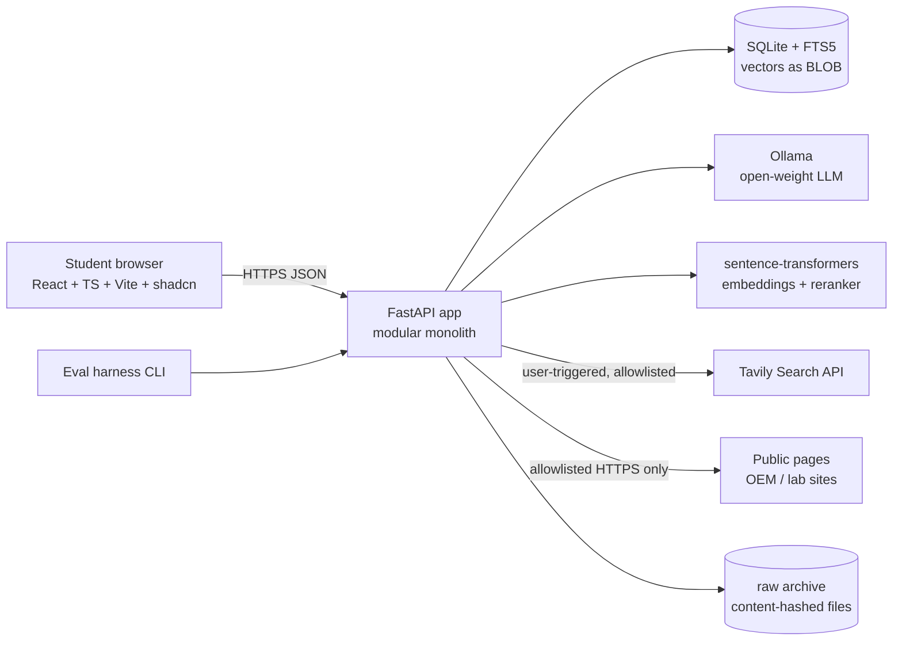
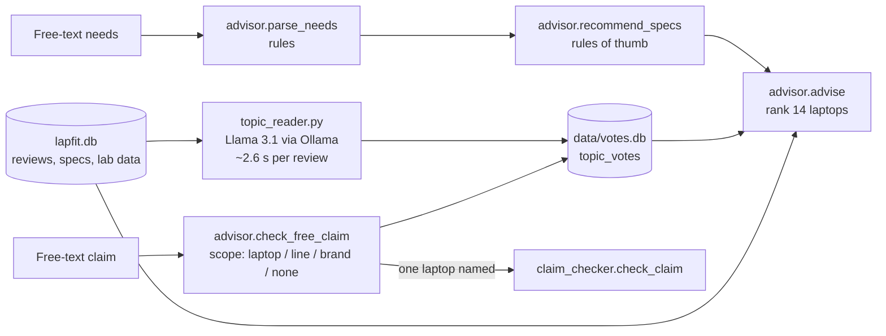
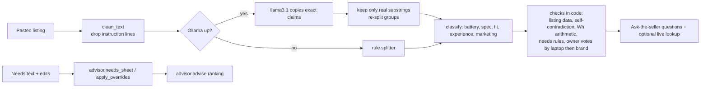

# ARCHITECTURE — LapFit (Stage 3 proposal for Gate 3)

Status: **Proposal.** Principles from the master prompt Parts 5, 7, 10: modular monolith, no training, LLM reads / code decides, provenance everywhere, honest failure.

## 1. System context


## 2. Technology choices (with rationale)
| Layer | Choice | Why / alternative considered |
|---|---|---|
| Frontend | React + TypeScript (strict) + Vite + Tailwind + shadcn/ui, TanStack Query, React Router, Zod | Team knows React; matches DESIGN_SYSTEM |
| Backend | Python 3.14 venv, FastAPI, Pydantic v2 | typed contracts end-to-end; Python ML ecosystem |
| ORM/migrations | SQLAlchemy 2.x + Alembic | portable to Postgres |
| **Store** | **SQLite (WAL) + FTS5; vectors in BLOB, brute-force cosine in NumPy** (≈10⁴–10⁵ vectors) | **Deviation from "Postgres+pgvector preferred":** no Postgres/Docker on the machine, slow network (CH-018), single-user demo, zero-ops reliability. Schema kept Postgres-portable; a documented migration path to Postgres + pgvector + `tsvector` is the scale-up. Decision D-pending-03 |
| Lexical search | SQLite FTS5 (BM25) | built in, fast |
| Vector search | embeddings in table + NumPy matmul; optional `sqlite-vec` later | exact search is trivial at this size |
| Fusion | Reciprocal Rank Fusion (k=60) | transparent, no tuning |
| Rerank | cross-encoder (benchmarked; deferred if no measurable gain) | latency/RAM budget |
| LLM | Ollama, open-weight 7–9B instruct; **provider interface** (`LLMProvider`) | no vendor lock-in; model chosen by benchmark (Qwen3 8B / Qwen2.5 7B / Llama 3.1 8B candidates; only Llama 3.1 8B installed today) |
| Embeddings | candidate: `intfloat/multilingual-e5-base`, `BAAI/bge-m3`, MiniLM-L12 multilingual (baseline) | benchmark on Hinglish/shorthand gold queries |
| Live search | Tavily Search API (verified 2026-11-10: free 1,000 credits/mo, no card; basic/fast=1 credit, advanced=2; Bearer auth; `include_domains` ≤300) behind `SearchProvider` | key in `.env` (never in repo) |
| Page extraction | httpx + trafilatura + BeautifulSoup | permitted pages only |
| Jobs | `asyncio` tasks + `jobs` table (resumable); no Celery | simplest viable |
| Observability | structured JSON logs + request/trace IDs + per-stage timings in `traces` table; Langfuse optional later | prompt/model/version recorded on every generated row |
| Eval | pytest + custom harness (ported from team's `eval_metrics.py`), Ragas for selected RAG metrics | deterministic assertions first |

## 3. Module boundaries (backend `lapfit/`)
`catalog` · `profiles` · `sources` (registry, policy, allowlist) · `ingestion` · `extraction` · `embeddings` · `retrieval` (filters+FTS+vector+RRF) · `reranking` · `evidence` (provenance, quote/number validators) · `fit_engine` (gate, ratings, coverage — deterministic) · `claim_checker` (router, decomposition, verdict ladder) · `research` (live pipeline) · `comparison` · `evaluation` · `observability` · `api`. Rule: modules call each other only through typed service interfaces; no module imports `api`.

## 4. Pipelines
### A. Offline ingestion (idempotent, resumable)
adapter → policy check → raw archive (hash) → normalise (keep original text) → **dedup** (exact + normalised + MinHash/embedding near-dup clusters) → variant resolution (listing-level; sibling detection by model-code parse) → LLM structured extraction (Pydantic, enum topics, `unknown/not_stated`) → **deterministic validation** (quote ⊂ original, IDs, units, taxonomy) → embed → index → audit report. One bad record never stops a batch; errors stored.
### B. Online fit analysis
resolve variant → SQL spec facts & **requirement gate** (Met/Not met/Unknown; Spec mismatch) → per-category query expansion from profile → hybrid retrieval (filters: variant, source permission) → RRF → (rerank) → applicability classification (profile + variant; `unknown` by default) → dedup-aware counting → rules (dealbreaker ≥2 independent clear applicable; watch-out; <3 → insufficient) → rating engine (weights, coverage, threshold) → LLM drafts summary **only from validated evidence IDs** → validators on every quote/number → typed response (+ raw-evidence fallback if any stage fails).
### C. Claim Checker
parse → **router** (spec / measured / experiential / predictive) → decompose to sub-claims → clarifier (only if answer would change) → per-type engine: spec = exact `spec_facts` lookup; measured = `benchmarks` + condition normaliser (comparability matrix); experiential = retrieval + applicability + counts; predictive = requirement decomposition → recurse → **mandatory counter-evidence query** → verdict ladder (deterministic, MVP_SCOPE §4) → explanation with evidence IDs → validators → "doesn't prove / would change / checklist" generated from gaps by templates + LLM wording.
### D. Live research (D-015) — as built (see D-029): extraction is deterministic regex with exact quotes (no LLM on unseen pages); search is Tavily behind `SearchProvider`; transient-refusal fallback to provider text. Original design below.

`POST /research` → resolve identity → `SearchProvider` (Tavily; `include_domains` = allowlist; credits budget guard) → candidate URLs → **SourcePolicy gate**: https only; domain in allowlist or link-only; robots.txt via `urllib.robotparser`; DNS resolve + block private/link-local/loopback IPs (SSRF); re-validate every redirect hop; size ≤2 MB, time ≤15 s; content-type html/text → fetch → trafilatura → section → LLM extraction of spec/benchmark facts with **verbatim quote + units + conditions** → validators reject facts whose quote isn't in the page → store `documents` + `spec_facts`/`benchmarks` with provenance, hash, retrieval time → embed → report labelled "researched live". Cache by (url, content_hash). Credit budget tracked in DB (hard stop at 80% of monthly free credits).
Default allowlist (to verify terms before enabling): manufacturer domains (apple.com, asus.com, lenovo.com, hp.com, dell.com, acer.com, msi.com …); independent-lab domains only after terms review (notebookcheck.net, rtings.com, laptopmedia.com — link-only until permission/terms confirmed).

## 5. Determinism boundary (what the LLM may and may not do)
LLM: extract claims/facts, classify applicability, cluster paraphrases, draft wording, parse the free-text profile, decompose claims. Code: counting, thresholds, rating arithmetic, verdict ladder, comparability checks, quote/number/unit validation, allowlists, budgets. Any LLM output failing schema validation → bounded retry (≤2) → fallback state.

## 6. Security & privacy (Part 10)
Untrusted-content delimiting in prompts + injection tests; no secrets in frontend/repo (`.env.example`); CORS locked to the dev origin; rate limits on expensive routes; request-size limits; HTML sanitised (text only rendered via `textContent`/React escaping); SSRF guard above; admin routes (ingest, eval, re-index) behind a local token; profile stored in browser (localStorage) by default — server keeps no PII; analytics logs contain no review text or free-text profile content.

## 7. Reliability
Bounded retries; model health check + readiness endpoint; per-stage timeouts; cache keys include model/prompt/data versions; never show half-built evidence as final; UI fallbacks per FEATURE_FLOWS J12.

## 8. Mapping "wow" features (Part 9) to implementation
Workload→fit engine (B) · Variant resolver (model-code parser + listing identity + `variant_match` enum) · Evidence graph (tables `evidence_claims`↔`reviews`/`benchmarks`/`spec_facts`↔`sources`; navigable via `/evidence/{id}`) · Counter-evidence retrieval (C, mandatory) · Evidence-gap detector (coverage matrix → gap list → checklist) · Condition-aware comparison (condition normaliser) · Applicability explanation (`exclusion_log`) · Injection-resistant ingestion (delimiting + FK-ADV tests) · Reproducible eval harness + Trust page · Correction loop (`feedback` → eval candidates).

## 9. Repo layout (to be created at Gate 4)
```
prototype_prathyusha/
  backend/lapfit/{catalog,profiles,sources,ingestion,extraction,embeddings,retrieval,reranking,evidence,fit_engine,claim_checker,research,comparison,evaluation,observability,api}/
  backend/prompts/        # versioned prompt files (v1/…)
  backend/migrations/     # Alembic
  backend/tests/
  eval/                   # golden sets, runners, reports
  frontend/               # Vite app
  lapfit_data_pack/       # existing data scripts + curated data
  docs/
```

## 10. Open architecture decisions (for Gate 3)
D-pending-02 LLM + embedding + reranker (after benchmark) · D-pending-03 SQLite vs Postgres · D-019 Tavily approved (done, key via `.env`) · domain allowlist contents.


## As built (2026-11-11) — deltas from the proposal
- Store: SQLite (WAL) + FTS5 + NumPy vectors, versioned SQL migrations (001 init, 002 research), as approved (D-021/D-022).
- LLM: only `llama3.1:latest` (8B) via Ollama; Qwen models never downloaded (network, CH-018). Embeddings: multilingual MiniLM (e5-base not usable; CH-028). No reranker.
- Report text is **rule-built** (no model writes it) — stricter than the proposal's "LLM drafts from validated IDs".
- Live research extracts facts with **deterministic regex + exact quotes**, not an LLM; search is Tavily; fallback to provider page text only on 429/5xx; Notebookcheck spec pages allowed (D-033).
- Claim Checker router is rule-based (no LLM), five claim types, mandatory counter-evidence search.
- Not built: adaptive interview/free-text profile parsing, reranker, LangGraph/Langfuse, admin endpoints, durable job queue (threads + DB rows), rate limiting, user accounts.
- Deterministic post-model guards on extraction (category, strength, polarity, case-only quote repair) are part of the pipeline (D-035).

## As built — pivot additions (2026-11-11)

- `topic_reader.py` writes `votes.db` (separate file: rebuilding `lapfit.db` cannot erase hours of reading). Table `topic_votes(review_id, topic, opinion, quote…)`, `topic_done`.
- `advisor.py` has no model call at request time.

## As built: Listing Lie Detector and needs sheet (2026-11-11)

AI at request time: only the claim splitter. AI ahead of time: topic reader (votes.db) and embeddings. Everything that decides a verdict is code.


## Final state pointer (2026-11-11)
AI map and data flow in `FINAL_STATE_2026-11-11.md` sections 3 to 7. Summary: two stores (`lapfit.db`, `votes.db`), one local model (Llama 3.1 via Ollama) used offline to read reviews and online only to split a pasted listing, MiniLM embeddings for same-meaning search, everything else deterministic code behind FastAPI; frontend React + Vite; needs and listing text stay in the browser.
